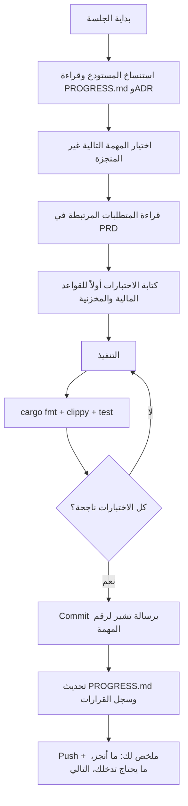
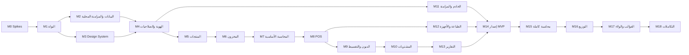
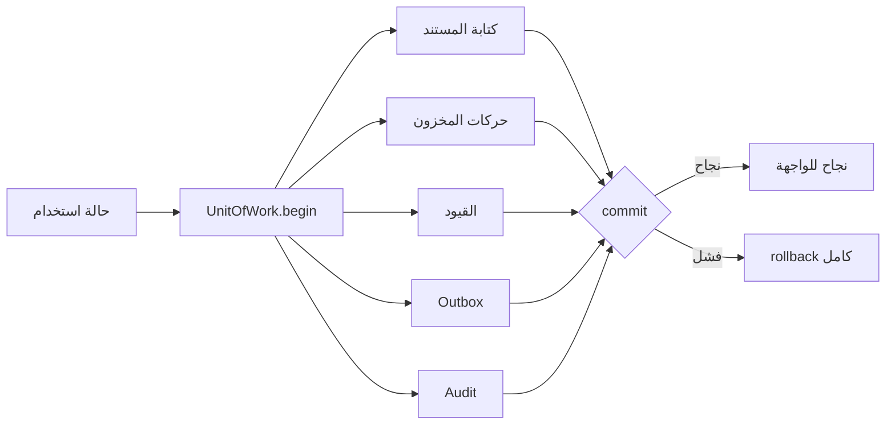
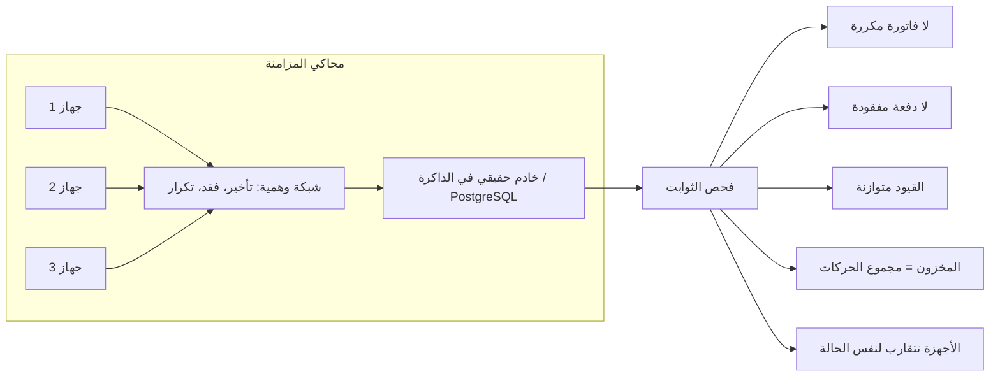

# NSH Business — خطة التنفيذ الكاملة
### خطة عمل قابلة للتنفيذ من طرف Claude، مرحلةً بمرحلة ومهمةً بمهمة

| الحقل | القيمة |
|---|---|
| الوثيقة المرجعية | NSH_Business_PRD_AR.md (v1.0) |
| المنفّذ | Claude (جلسات عمل متتالية) + صاحب المشروع (مراجعة، اختبار أجهزة، نشر) |
| الإطار | NSH v0.4.0 (أحدث إصدار وقت كتابة الخطة)، قالب Rust |
| اللغة | Rust للعميل والخادم، TSX غير مستخدم إلا بقرار لاحق |
| حالة الوثيقة | خطة أساس، تُحدَّث في نهاية كل مرحلة |

---

## 0. كيف ستعمل هذه الخطة عملياً

### 0.1 ما يستطيع Claude فعله، وما يحتاج إليك

| العمل | Claude | أنت |
|---|---|---|
| كتابة الشيفرة Rust (النواة، المجال، الخادم، الواجهات) | ✅ | مراجعة |
| كتابة الاختبارات وتشغيلها | ✅ (Linux) | — |
| بناء وتشغيل هدف Linux وهدف Web (WASM) | ✅ غالباً، بعد التحقق في Spike | — |
| تشغيل PostgreSQL للاختبار | ✅ إن أمكن تثبيته في بيئة العمل، وإلا اختبارات SQLite + توثيق | تشغيل على جهازك عند الحاجة |
| بناء Windows / Android | ⚠️ محاولة بناء متقاطع؛ غير مضمون في بيئتي | البناء والتشغيل الفعلي |
| بناء macOS / iOS | ❌ يتطلب macOS وXcode | البناء والتشغيل |
| اختبار الطابعات والموازين والماسحات الحقيقية | ❌ لا أجهزة في بيئتي | الاختبار الفعلي وإرسال النتائج/السجلات |
| تصميم الواجهات (Design System، النماذج البصرية) | ✅ | القرار البصري النهائي |
| النشر على متاجر التطبيقات والخوادم | ❌ | ✅ |
| القرارات التجارية والقانونية (الضرائب، التقسيط) | اقتراح فقط | القرار + محاسب/قانوني |

### 0.2 شرط أساسي: مستودع GitHub

بيئة عملي لا تحتفظ بالملفات بين المحادثات المختلفة. لذلك:

1. تنشئ مستودعاً على GitHub (خاصاً) باسم مثل `nsh-business`، وتمنح Claude صلاحية الوصول إليه.
2. كل جلسة عمل: أستنسخ المستودع ← أقرأ `docs/PROGRESS.md` ← أنفّذ المهمة التالية ← أختبر ← أرفع التغييرات (commit + push) ← أحدّث `PROGRESS.md`.
3. لا تبدأ أي جلسة من الذاكرة؛ المستودع هو الحقيقة الوحيدة.

### 0.3 بروتوكول الجلسة الواحدة



### 0.4 ملفات التحكم في المستودع

| الملف | الغرض |
|---|---|
| `docs/PRD.md` | وثيقة المتطلبات |
| `docs/PLAN.md` | هذه الخطة |
| `docs/PROGRESS.md` | حالة كل مهمة: ⬜ لم تبدأ / 🟨 جارية / ✅ منجزة / ⛔ متوقفة (مع السبب) |
| `docs/adr/NNNN-*.md` | سجل القرارات المعمارية |
| `docs/NEEDS_OWNER.md` | ما ينتظر تدخلك (اختبار جهاز، قرار، بناء macOS…) |
| `CLAUDE.md` | قواعد العمل الثابتة لأي جلسة (الأسلوب، الأوامر، المحظورات) |

### 0.5 تعريف "منجز" (Definition of Done) لأي مهمة

- الشيفرة تُبنى دون تحذيرات `clippy` (مستوى `-D warnings`).
- اختبارات الوحدة للقواعد الجديدة موجودة وناجحة.
- لا استخدام لـ `f32/f64` في المال أو الكميات.
- أي تغيير في المخطط له ترحيل (Migration) واختبار ترحيل.
- أي عملية تكتب بيانات مالية/مخزنية: ذرية + Outbox + Idempotency.
- النصوص الظاهرة عبر نظام الترجمة (ar/en/fr)، ولا نص مضمّن.
- `PROGRESS.md` محدّث.

---

## 1. نظرة عامة على المراحل

```mermaid
gantt
    title خارطة التنفيذ (تقدير بعدد جلسات العمل، وليس بأيام)
    dateFormat X
    axisFormat %s
    section الأساس
    M0 Spikes والتحقق من NSH        :m0, 0, 6
    M1 هيكل المشروع والنواة          :m1, after m0, 8
    M2 طبقة البيانات والمزامنة المحلية :m2, after m1, 10
    M3 Design System والواجهة الأساسية :m3, after m1, 10
    section الأعمال P0
    M4 الهوية والمؤسسات والصلاحيات    :m4, after m2, 8
    M5 المنتجات والوحدات والباركود    :m5, after m4, 10
    M6 المخزون والمستودعات            :m6, after m5, 10
    M7 المحاسبة الأساسية              :m7, after m6, 10
    M8 POS والمبيعات                  :m8, after m7, 14
    M9 العملاء والديون والتقسيط        :m9, after m8, 12
    M10 المشتريات                     :m10, after m9, 8
    section المنصة
    M11 الخادم والمزامنة السحابية      :m11, after m4, 16
    M12 الطباعة والمستندات والأجهزة    :m12, after m8, 10
    M13 التقارير ولوحة التحكم          :m13, after m10, 8
    M14 النسخ والاستيراد والإصدار MVP  :m14, after m13, 8
    section ما بعد MVP
    M15 المحاسبة الكاملة               :m15, after m14, 12
    M16 التوزيع والبيع الميداني        :m16, after m15, 12
    M17 مصمم القوالب والعروض والولاء   :m17, after m16, 12
    M18 التكاملات والبوابات والتحسين   :m18, after m17, 14
```



> **التقدير:** المراحل M0–M14 (حتى MVP) قرابة 150 جلسة عمل مركّزة. الرقم تقديري ويتغير بنتائج M0 وبسرعة المراجعة والاختبار من طرفك.

### 1.1 الاعتماديات بين المراحل



### 1.2 بوابات المراجعة (Gates)

لا تبدأ المرحلة التالية قبل موافقتك عند هذه النقاط:

| البوابة | بعد | ما تراجعه |
|---|---|---|
| G0 | M0 | تقرير جدوى NSH: هل نستمر به كإطار للواجهة؟ |
| G1 | M3 | الهوية البصرية وشاشة نموذجية على الهاتف وسطح المكتب |
| G2 | M7 | مصفوفة القيود المحاسبية (يُفضل مع محاسب) |
| G3 | M8 | تجربة POS على جهاز حقيقي (سرعة، سهولة) |
| G4 | M11 | اختبار المزامنة بين جهازين دون اتصال |
| G5 | M14 | قبول MVP وفق قائمة معايير PRD |

---

## 2. M0 — Spikes والتحقق من الإطار (6 جلسات)

**الهدف:** إثبات أن NSH v0.4 يصلح للمشروع قبل كتابة أي منطق أعمال، لأن الإطار حديث (إصدار 0.x) وواجهاته قد تتغير.

| # | المهمة | المخرج | معيار القبول |
|---|---|---|---|
| M0.1 | تثبيت `nsh` في بيئة العمل، `nsh init --template rust`، تشغيل `--target linux` و`--target web` | تطبيق Hello يعمل | يُبنى ويعمل على Linux والويب |
| M0.2 | قراءة `llms.txt` ووثائق NSH (Rust، nsh/base، الجداول، الحوارات، التنقل، التخزين، الويب) | `docs/spikes/nsh-capabilities.md` | جرد للمكونات المتاحة وحدودها |
| M0.3 | Spike: SQLite من Rust داخل تطبيق NSH (rusqlite أو sqlx) + أداء 100 ألف منتج وبحث FTS5 | تقرير أداء | بحث < 150ms على بيانات مرجعية |
| M0.4 | Spike: التخزين الدائم على الويب (SQLite-WASM + OPFS أو IndexedDB) من Rust/WASM | تقرير + نموذج | كتابة/قراءة معاملات تبقى بعد إعادة التحميل |
| M0.5 | Spike: العربية وRTL في NSH (الاتجاه، الخطوط، النص المختلط، الجداول) | لقطات شاشة | عرض عربي صحيح على Linux والويب |
| M0.6 | Spike: قائمة منتجات افتراضية (Virtualized) 10 آلاف عنصر + شبكة POS | نموذج | تمرير سلس دون تقطّع |
| M0.7 | محاولة بناء Android وWindows متقاطعاً | تقرير | نجاح أو توثيق المانع وتحويله إلى `NEEDS_OWNER.md` |
| M0.8 | Spike طباعة: توليد أوامر ESC/POS وملف PDF من Rust | ملفات ناتجة | ملف ESC/POS صالح + PDF عربي سليم |
| M0.9 | **تقرير الجدوى G0** وADR-0001 (اختيار الإطار) وADR-0002 (المكتبات) | `docs/adr/` | قرار موثق مع خطة بديلة |

**الخطة البديلة إن فشل NSH في نقطة جوهرية:** يبقى كل منطق الأعمال في crates مستقلة عن الواجهة (هذا مضمون بالتصميم)، وتُستبدل طبقة الواجهة فقط (مثلاً Dioxus أو Slint أو Tauri) دون إعادة كتابة النواة.

**مهامك في M0:** إنشاء مستودع GitHub، تجربة النسخة على Windows/Android/macOS إن تعذر عليّ بناؤها.

---

## 3. M1 — هيكل المشروع والنواة (8 جلسات)

### 3.1 هيكل الـ Workspace

```text
nsh-business/
├── Cargo.toml                 # workspace
├── CLAUDE.md
├── docs/ (PRD, PLAN, PROGRESS, adr/, NEEDS_OWNER)
├── crates/
│   ├── nb-core/               # Money, Quantity, Ids, Clock, Errors, Result
│   ├── nb-i18n/               # الترجمة ar/en/fr + تنسيق الأرقام والتواريخ
│   ├── nb-domain/             # الكيانات وقواعد المجال (بلا IO)
│   ├── nb-app/                # حالات الاستخدام + المنافذ (Ports/Traits)
│   ├── nb-store/              # SQLite: مخطط، ترحيلات، مستودعات
│   ├── nb-store-web/          # محول تخزين الويب (حسب نتيجة M0.4)
│   ├── nb-sync/               # Outbox/Inbox/Cursor/Conflicts (مشترك عميل/خادم)
│   ├── nb-contracts/          # عقود API والأحداث (serde)
│   ├── nb-docs/               # محرك المستندات و PDF و ESC/POS
│   ├── nb-hardware/           # HAL: طابعة، ميزان، ماسح، درج
│   └── nb-ui/                 # Design System ومكونات NSH المشتركة
├── apps/
│   └── client/                # تطبيق NSH الواحد لكل المنصات
├── server/
│   └── nb-server/             # Axum + PostgreSQL
├── migrations/
│   ├── client/
│   └── server/
└── tests/
    ├── e2e/
    └── sync-sim/              # محاكاة أجهزة متعددة
```

> يُبدأ بعدد crates قليل، وتُفصل الوحدات التجارية (sales, inventory…) كـ modules داخل `nb-domain` و`nb-app`، وتُفصل إلى crates مستقلة فقط عند الحاجة.

### 3.2 المهام

| # | المهمة | معيار القبول |
|---|---|---|
| M1.1 | Workspace + CI (GitHub Actions: fmt, clippy, test لـ Linux) | CI أخضر |
| M1.2 | `CLAUDE.md`: قواعد الشيفرة والأوامر والمحظورات | موجود ومطبق |
| M1.3 | `nb-core::Money` (عدد صحيح بأصغر وحدة + رمز العملة + دقة) وعمليات آمنة وسياسة تقريب | اختبارات خصائص (proptest): لا فقد عند الجمع والتوزيع |
| M1.4 | `Money::allocate` لتوزيع مبلغ على أجزاء دون فقد سنتيم (للأقساط والخصومات) | مجموع الأجزاء = الأصل دائماً |
| M1.5 | `nb-core::Quantity` (Decimal + وحدة) و`Rate`/`Percent` | اختبارات |
| M1.6 | المعرفات: UUIDv7 مكتوبة بأنواع مستقلة (`ProductId`…) | لا خلط بين الأنواع وقت الترجمة |
| M1.7 | الساعة: `Clock` قابل للحقن + ساعة منطقية هجينة (HLC) لترتيب الأحداث | اختبارات انحراف الساعة |
| M1.8 | نموذج الأخطاء الموحد والرسائل المترجمة | — |
| M1.9 | `nb-i18n`: ملفات ترجمة، تنسيق أرقام/عملات/تواريخ، اتجاه RTL | ar/en/fr تعمل |
| M1.10 | ADR-0003 أسلوب المعمارية (Hexagonal: Domain بلا IO، App بمنافذ، Infra بمحولات) | موثق |

---

## 4. M2 — طبقة البيانات والمحرك المحلي (10 جلسات)

| # | المهمة | معيار القبول |
|---|---|---|
| M2.1 | اختيار مكتبة SQLite (حسب M0.3) وإعداد WAL، foreign_keys، busy_timeout | — |
| M2.2 | نظام ترحيلات مرقّم + نسخة احتياطية تلقائية قبل الترحيل | اختبار ترقية من v1 إلى v2 |
| M2.3 | الحقول المشتركة لكل جدول: id, org_id, created_at, updated_at, created_by, device_id, version, deleted_at | قالب موحد |
| M2.4 | `UnitOfWork`: معاملة واحدة تجمع كل كتابات حالة الاستخدام | فشل في المنتصف = لا أثر |
| M2.5 | جدول `outbox_events` يُكتب داخل المعاملة نفسها | اختبار: لا عملية دون حدث ولا حدث دون عملية |
| M2.6 | جدول `operations` لـ Idempotency (operation_id فريد) | تكرار التنفيذ = النتيجة نفسها |
| M2.7 | سجل التدقيق `audit_log` بسلسلة تجزئة (hash chain) | كشف التلاعب في اختبار |
| M2.8 | ترقيم المستندات دون اتصال: بادئة الجهاز + عدّاد محلي لكل (نوع، فرع، سنة) | لا تكرار بين جهازين في المحاكاة |
| M2.9 | Repository traits في `nb-app` ومحولات SQLite في `nb-store` | — |
| M2.10 | محول تخزين الويب بنفس الـ traits | اختبارات المطابقة تمر على المحولين |
| M2.11 | مجموعة "اختبارات المطابقة" (Conformance) لأي محول تخزين | تُشغّل على SQLite والويب |
| M2.12 | مولد بيانات مرجعية (100k منتج، 1M حركة) للاختبار والأداء | سكربت قابل للتكرار |



---

## 5. M3 — Design System والواجهة الأساسية (10 جلسات، بالتوازي مع M2)

| # | المهمة | معيار القبول |
|---|---|---|
| M3.1 | Design Tokens: ألوان دلالية (فاتح/داكن)، مسافات، أحجام، حواف، ظلال | ملف tokens واحد |
| M3.2 | الخطوط: خط عربي/لاتيني واضح بترخيص مفتوح (مثل IBM Plex Sans Arabic أو Noto) | عرض سليم |
| M3.3 | مكونات أساسية فوق `nsh/base`: Button, Input, NumberInput, MoneyInput, Select, Checkbox, Switch, Badge | كل مكون بحالاته: عادي/تعطيل/خطأ/تحميل |
| M3.4 | Dialog, Drawer/Sheet, Popover, Menu, Tabs, Toast | — |
| M3.5 | DataTable: أعمدة مثبتة، فرز، فلترة، اختيار جماعي، افتراضية، RTL | 10k صف بسلاسة |
| M3.6 | Layout متجاوب: Sidebar (سطح المكتب) / Bottom Nav (الهاتف) / Split (تابلت) | يتبدل حسب العرض |
| M3.7 | حالات الفراغ والتحميل (Skeleton) والخطأ | — |
| M3.8 | Command Palette + اختصارات لوحة المفاتيح | Ctrl/Cmd+K |
| M3.9 | مؤشر حالة المزامنة (أيقونة + نص) | الحالات الثمانية في PRD §8.5 |
| M3.10 | معرض مكونات داخلي (Gallery screen) للمراجعة | **بوابة G1** |

**مهامك:** مراجعة الهوية البصرية، اختيار اللون الأساسي والشعار.

---

## 6. M4 — الهوية والمؤسسات والصلاحيات (8 جلسات)

| # | المهمة | معيار القبول |
|---|---|---|
| M4.1 | كيانات: Organization, Branch, Warehouse, CashRegister, BusinessProfile | CRUD + اختبارات |
| M4.2 | معالج الإعداد الأول (Onboarding): اسم، نشاط، دولة، عملة، لغة، سنة مالية | يكتمل في < 2 دقيقة |
| M4.3 | ملفات الأنشطة (Activity Profiles) كبيانات JSON تفعّل الميزات | تغيير النشاط يغير الوحدات الظاهرة |
| M4.4 | Feature Toggles | — |
| M4.5 | المستخدمون، الأدوار، الصلاحيات (قائمة صلاحيات ثابتة مرقمة في الشيفرة) | — |
| M4.6 | محرك التفويض: (صلاحية × نطاق فرع/مستودع/صندوق) | اختبارات مصفوفة |
| M4.7 | دخول محلي: كلمة مرور (argon2) + PIN سريع للكاشير + قفل تلقائي | — |
| M4.8 | تفويض المشرف دون اتصال (PIN مشرف يُسجَّل في التدقيق) | — |
| M4.9 | شاشات الإعدادات: المؤسسة، الفروع، المستخدمون، الأدوار | — |

---

## 7. M5 — المنتجات والوحدات والباركود (10 جلسات)

| # | المهمة | معيار القبول |
|---|---|---|
| M5.1 | التصنيفات الهرمية والعلامات التجارية والوسوم | — |
| M5.2 | الوحدات: أنواع، وحدة أساسية، تحويلات عامة وخاصة بالمنتج، دقة لكل وحدة | 1 كرتون = 12 علبة = 72 قطعة صحيح |
| M5.3 | المنتج البسيط والخدمة | — |
| M5.4 | المتغيرات (سمات × قيم → مصفوفة متغيرات) | توليد آلي للمتغيرات |
| M5.5 | باركودات متعددة + منع التكرار + تحقق من check digit | EAN-13 صالح/غير صالح |
| M5.6 | محلل الباركود الموزون القابل للتهيئة (بادئة، طول الصنف، وزن/سعر، دقة) | اختبارات صيغ متعددة |
| M5.7 | قوائم الأسعار: تجزئة/جملة/عميل/فرع/كمية + حد أدنى + سجل الأسعار | محرك اختيار السعر باختبارات |
| M5.8 | الضرائب: فئات ضريبية ونسب (مضمّنة/مضافة) | اختبارات التقريب |
| M5.9 | الصور والمرفقات (تخزين محلي) | — |
| M5.10 | شاشات المنتجات: قائمة، بحث FTS، نموذج، متغيرات، استيراد CSV مبسّط | بحث < 150ms |

---

## 8. M6 — المخزون والمستودعات (10 جلسات)

| # | المهمة | معيار القبول |
|---|---|---|
| M6.1 | `stock_movements` (append-only): نوع، كمية بالوحدة الأساسية، مستودع، موقع، مصدر، دفعة/تسلسل، تكلفة | لا UPDATE ولا DELETE |
| M6.2 | إسقاط الأرصدة `stock_balances` يُحدَّث داخل المعاملة + أداة إعادة بناء | إعادة البناء = الإسقاط |
| M6.3 | سياسة المخزون السالب (منع/سماح بصلاحية) | — |
| M6.4 | الحجز وفك الحجز، الرصيد المتاح | — |
| M6.5 | التحويلات بين المستودعات (صرف ← بالطريق ← استلام ← فروقات) | — |
| M6.6 | التسويات والإتلاف مع أسباب واعتماد | — |
| M6.7 | الجرد (جلسة جرد، إدخال بالماسح، فروقات، اعتماد) | — |
| M6.8 | الدفعات وتواريخ الانتهاء + FEFO اختياري | — |
| M6.9 | الأرقام التسلسلية | لا يباع الرقم مرتين |
| M6.10 | التقييم: المتوسط المرجح أولاً، ثم FIFO (طبقات تكلفة) | اختبارات حسابية |
| M6.11 | تنبيهات المخزون المنخفض والصلاحية | — |
| M6.12 | شاشات: الأرصدة، حركة صنف، التحويل، الجرد | — |

---

## 9. M7 — المحاسبة الأساسية (10 جلسات)

| # | المهمة | معيار القبول |
|---|---|---|
| M7.1 | دليل الحسابات الهرمي + دليل افتراضي قابل للتعديل (مع توطين الجزائر مقترحاً للمراجعة) | — |
| M7.2 | السنوات والفترات المالية، الحماية بعد الإقفال | لا ترحيل في فترة مغلقة |
| M7.3 | `journal_entries` + `journal_lines` (append-only بعد الترحيل) | قيد غير متوازن يُرفض |
| M7.4 | القيد العكسي | — |
| M7.5 | محرك قواعد القيود الآلية (AccountingRule: حدث → حسابات) قابل للتهيئة | — |
| M7.6 | **مصفوفة القيود** لكل عملية (بيع نقدي/آجل، تكلفة مبيعات، تحصيل، شراء، مرتجع، عجز جرد، فروق صندوق) | **بوابة G2** |
| M7.7 | الصناديق والحسابات البنكية كحسابات مرتبطة | — |
| M7.8 | ميزان المراجعة وكشف الحساب ودفتر الأستاذ | مجموع المدين = الدائن |
| M7.9 | اختبار ثابت (invariant) يعمل في CI: كل القيود المرحلة متوازنة | دائم |

---

## 10. M8 — نقطة البيع والمبيعات (14 جلسة)

| # | المهمة | معيار القبول |
|---|---|---|
| M8.1 | نموذج السلة (Cart) في المجال: أسطر، وحدات، أسعار، خصومات، ضرائب، إجماليات | اختبارات حسابية شاملة |
| M8.2 | محرك التسعير والخصم (سطر/فاتورة، نسبة/مبلغ، حدود الصلاحية، الحد الأدنى للسعر) | — |
| M8.3 | الدفع: نقد، بطاقة، تحويل، آجل، مختلط، جزئي، حساب الباقي | المجموع يطابق دائماً |
| M8.4 | حالة الاستخدام `CompleteSale` الذرية: فاتورة + دفعات + مخزون + قيود + Outbox + Audit | فشل أي جزء = لا شيء |
| M8.5 | Idempotency على مستوى الزر (operation_id يُنشأ عند فتح شاشة الدفع) | النقر المزدوج = فاتورة واحدة |
| M8.6 | الورديات: فتح، حركات نقدية، إغلاق، عجز/زيادة | — |
| M8.7 | تعليق/استرجاع الفواتير، سلال متعددة | — |
| M8.8 | المرتجع والاستبدال مرتبطان بالفاتورة الأصلية | لا رد يتجاوز المؤهل |
| M8.9 | شاشة POS لسطح المكتب/التابلت (شبكة + سلة + دفع) | إضافة صنف بإحساس فوري |
| M8.10 | شاشة POS للهاتف (بحث/مسح + سلة منزلقة + دفع) | — |
| M8.11 | إدخال الماسح (HID كلوحة مفاتيح) + المسح بالكاميرا على الجوال | — |
| M8.12 | وضع البيع السريع + اختصارات | بيع صنف واحد نقداً في ≤ 3 تفاعلات |
| M8.13 | مستندات المبيعات: عرض سعر ← أمر ← فاتورة، حالات المستند | — |
| M8.14 | اختبارات e2e للبيع دون اتصال وإعادة التشغيل المفاجئ | **بوابة G3** |

---

## 11. M9 — العملاء والديون والتقسيط (12 جلسة)

| # | المهمة | معيار القبول |
|---|---|---|
| M9.1 | العملاء: بيانات، مجموعات، حد ائتمان، شروط سداد | — |
| M9.2 | دفتر العملاء الفرعي (AR) مبني على القيود + إسقاط الرصيد | الرصيد = مجموع الحركات |
| M9.3 | التحقق من حد الائتمان في POS وطلب الموافقة عند التجاوز | — |
| M9.4 | سند القبض + `payment_allocations` (لفاتورة، لعدة فواتير، غير مخصص) | — |
| M9.5 | كشف حساب العميل وأعمار الديون (0-30-60-90+) | — |
| M9.6 | خطة التقسيط: دفعة أولى، عدد، تكرار، تواريخ، توزيع التقريب عبر `Money::allocate` | المجموع = المستحق |
| M9.7 | دفع الأقساط (كلي/جزئي/مبكر)، حالات القسط، التأخر | — |
| M9.8 | إعادة الجدولة بنسخة جديدة مع الاحتفاظ بالقديمة والموافقة | — |
| M9.9 | الشطب والتسوية بصلاحية وقيد | — |
| M9.10 | الموردون ودفتر AP (بنية مماثلة) | — |
| M9.11 | المصروفات والإيرادات الأخرى | — |
| M9.12 | الشاشات: العميل 360°، التحصيل السريع، جدول الأقساط، المتأخرون | — |

---

## 12. M10 — المشتريات (8 جلسات)

| # | المهمة |
|---|---|
| M10.1 | أمر الشراء وحالاته والاعتماد |
| M10.2 | الاستلام الكلي/الجزئي ← حركات مخزون |
| M10.3 | فاتورة الشراء ومطابقتها بالأمر والاستلام |
| M10.4 | التكلفة الواصلة (توزيع الشحن والمصاريف حسب القيمة/الكمية/الوزن) |
| M10.5 | تحديث التكلفة (متوسط مرجح/طبقات FIFO) |
| M10.6 | مرتجع المشتريات |
| M10.7 | سداد الموردين وتوزيعه |
| M10.8 | الشاشات |

---

## 13. M11 — الخادم والمزامنة السحابية (16 جلسة، تبدأ بعد M4 بالتوازي)

| # | المهمة | معيار القبول |
|---|---|---|
| M11.1 | `nb-server`: Axum + PostgreSQL + ترحيلات + إعدادات | يعمل محلياً |
| M11.2 | تعدد المؤسسات: `org_id` + Row Level Security (ADR) | لا تسرب بين مؤسستين في الاختبار |
| M11.3 | المصادقة (JWT قصير + Refresh) وتسجيل الأجهزة وإلغاؤها | — |
| M11.4 | `POST /sync/push`: دفعة عمليات بترتيب، Inbox لمنع التكرار، تحقق، تطبيق ذري | التكرار يعيد النتيجة نفسها |
| M11.5 | `GET /sync/pull?cursor=`: سجل تغييرات مرتب | — |
| M11.6 | محرك المزامنة في العميل: Backoff، دفعات، ترتيب سببي، حالات | — |
| M11.7 | سياسات التعارض لكل نوع (PRD §8.7) | — |
| M11.8 | مخزون متعدد الأجهزة: كشف العجز، سياسات قبول/تعليق/منع، حد بيع دون اتصال | — |
| M11.9 | شاشة التعارضات والعمليات المرفوضة | — |
| M11.10 | WebSocket لإشعار "توجد تغييرات" | — |
| M11.11 | رفع المرفقات القابل للاستئناف | — |
| M11.12 | **محاكي المزامنة الحتمي** (`tests/sync-sim`): N أجهزة، انقطاعات عشوائية، تكرار، انحراف ساعات، إعادة تشغيل | آلاف السيناريوهات دون تكرار أو فقد |
| M11.13 | Docker Compose للخادم + توثيق النشر | **بوابة G4** |



---

## 14. M12 — الطباعة والمستندات والأجهزة (10 جلسات)

| # | المهمة | ملاحظة |
|---|---|---|
| M12.1 | نموذج قالب المستند (JSON): عناصر، حقول ديناميكية، مقاسات | أساس مصمم القوالب لاحقاً |
| M12.2 | محرك PDF مع العربية (تشكيل الحروف، RTL) — A4/A5 | يُحسم المحرك في M0.8 |
| M12.3 | مولد ESC/POS للإيصال الحراري 58/80مم مع العربية (طباعة كصورة نقطية عند عدم دعم الطابعة للعربية) | — |
| M12.4 | HAL: `Printer`, `Scale`, `Scanner`, `CashDrawer` traits + أجهزة وهمية للاختبار | — |
| M12.5 | نقل الطباعة: TCP/IP (منفذ 9100)، USB، Bluetooth حسب المنصة | **اختبار فعلي من طرفك** |
| M12.6 | تعريف ميزان عبر Serial/TCP بملفات تعريف | **اختبار فعلي من طرفك** |
| M12.7 | ملصقات الباركود (TSPL/ZPL أو صورة) | — |
| M12.8 | القوالب الافتراضية: إيصال، فاتورة A4، سند قبض، جدول أقساط، ملصق | — |
| M12.9 | مصفوفة توافق الأجهزة (تُملأ من نتائج اختباراتك) | — |

---

## 15. M13 — التقارير ولوحة التحكم (8 جلسات)

المبيعات (يومي/حسب الصنف/الكاشير/الفرع/وسيلة الدفع)، الأرباح، المخزون (الرصيد، القيمة، الحركة، الراكد)، الذمم وأعمار الديون، الأقساط المتأخرة، تقرير الوردية، ميزان المراجعة، لوحة تحكم بودجات، التصدير CSV/PDF. كل تقرير يحترم الصلاحيات (إخفاء التكلفة والربح).

---

## 16. M14 — النسخ والاستيراد وإصدار MVP (8 جلسات)

| # | المهمة |
|---|---|
| M14.1 | النسخ الاحتياطي المحلي المشفّر + الجدولة + التحقق |
| M14.2 | الاستعادة + إعادة بناء الإسقاطات |
| M14.3 | معالج الاستيراد (منتجات، عملاء، موردون، أرصدة افتتاحية) بمطابقة الأعمدة والمعاينة |
| M14.4 | تشفير قاعدة البيانات المحلية (SQLCipher أو بديل) وتخزين المفتاح في مخزن النظام الآمن |
| M14.5 | اختبارات الأداء على البيانات المرجعية |
| M14.6 | تدقيق أمني ذاتي (OWASP ASVS المستوى 1 للخادم) |
| M14.7 | التغليف: `nsh package` لكل منصة متاحة لي + تعليمات بناء البقية |
| M14.8 | تشغيل قائمة قبول MVP (PRD §21.1 و§20.6) | **بوابة G5** |

---

## 17. ما بعد MVP

| المرحلة | المحتوى |
|---|---|
| M15 المحاسبة الكاملة | القوائم المالية، الإقفال السنوي، مراكز التكلفة، تعدد العملات وفروق الصرف، الأصول والإهلاك، التسوية البنكية |
| M16 التوزيع | المندوبون، المركبات كمستودعات، التحميل/التفريغ، المسارات، الزيارات، Van Sales دون اتصال، إثبات التسليم، العمولات، تسوية العهدة |
| M17 القوالب والولاء | مصمم قوالب بالسحب والإفلات، العروض (X+Y، الشرائح)، الكوبونات، النقاط، بطاقات الهدايا |
| M18 التكاملات والتحسين | REST API عامة + Webhooks، بوابة العميل، المطاعم (طاولات وطلبات)، تحليلات متقدمة، اشتراكات SaaS |

---

## 18. استراتيجية الاختبار

| الطبقة | الأداة | ما يُختبر |
|---|---|---|
| وحدة | `cargo test` | قواعد المجال |
| خصائص | `proptest` | المال، التوزيع، التحويلات، التقسيط |
| ثوابت | اختبارات CI دائمة | توازن القيود، المخزون = الحركات، لا تكرار |
| تخزين | Conformance suite | SQLite والويب يتصرفان بالمثل |
| مزامنة | محاكي حتمي | تعدد الأجهزة والانقطاع |
| واجهة | `nsh test` (headless) | التدفقات الأساسية |
| e2e | سيناريوهات كاملة | شراء ← بيع ← تحصيل ← تقرير |
| أداء | بيانات مرجعية | أهداف PRD §17.1 |
| يدوي | أنت | الأجهزة، macOS/iOS، تجربة الاستخدام |

---

## 19. المخاطر الخاصة بالتنفيذ

| الخطر | الاحتمال | المعالجة |
|---|---|---|
| NSH v0.x يتغير أو ينقصه مكوّن | مرتفع | تثبيت الإصدار، طبقة `nb-ui` عازلة، خطة بديلة في ADR-0001 |
| تعذر بناء بعض المنصات في بيئتي | مؤكد لـ macOS/iOS | تعليمات بناء + `NEEDS_OWNER.md` |
| تخزين الويب لا يحقق المتطلبات | متوسط | M0.4 مبكراً، ويمكن تقليص نسخة الويب إلى إدارة وتقارير متصلة |
| العربية في الطباعة الحرارية | متوسط | طباعة الإيصال كصورة نقطية |
| حجم السياق بين الجلسات | مؤكد | المستودع + PROGRESS.md + مهام صغيرة |
| أخطاء محاسبية دقيقة | متوسط | مصفوفة قيود معتمدة + ثوابت CI + مراجعة محاسب |
| تضخم النطاق | مرتفع | لا شيء خارج المرحلة الحالية دون قرار مكتوب |

---

## 20. البدء الفوري

### ما أحتاجه منك الآن
1. إنشاء مستودع GitHub خاص (مثلاً `nsh-business`) وإضافته لهذه الجلسة أو إعطائي اسمه.
2. تأكيد: هل نستهدف الجزائر (DZD وTVA) كأول توطين؟
3. الأجهزة المتوفرة لديك للاختبار: نظام الحاسوب، الهاتف، الطابعة، الميزان (الطراز إن أمكن).

### أول ثلاث جلسات
1. **الجلسة 1:** M0.1 + M0.2 — تثبيت NSH، تطبيق Rust أولي على Linux والويب، جرد القدرات.
2. **الجلسة 2:** M0.3 + M0.5 — SQLite والأداء، العربية وRTL.
3. **الجلسة 3:** M0.4 + M0.6 — تخزين الويب، القوائم الكبيرة. ثم تقرير الجدوى G0.

---

**نهاية خطة التنفيذ — NSH Business**
