# NSH Business
## وثيقة متطلبات المنتج الشاملة (PRD)
### منصة موحّدة لإدارة الأعمال: المبيعات ونقاط البيع والمخزون والمحاسبة والتوزيع

| الحقل | القيمة |
|---|---|
| اسم المنتج | NSH Business |
| نوع الوثيقة | وثيقة متطلبات المنتج (PRD) |
| الإصدار | 1.0 |
| الحالة | خط أساس مقترح للتحليل والتصميم والتنفيذ |
| نمط التشغيل | هجين: Local-First + Cloud Sync |
| نطاق المنتج | شامل (Universal) قابل للتهيئة حسب النشاط |
| التقنية الأساسية | Rust + NSH (Native Shell) |
| المحاسبة | محاسبة كاملة بالقيد المزدوج |
| المنصات | Windows، macOS، Linux، Android، iOS، Web |
| اللغات | العربية (RTL)، الإنجليزية، الفرنسية |
| الجمهور | المنتج، التصميم، الهندسة، الاختبار، الإدارة |

> **الغرض:** تحديد رؤية المنتج ونطاقه ووحداته ومتطلباته الوظيفية وغير الوظيفية وتجربة المستخدم ومعمارية Local-First، لتكون مرجعاً لإعداد SRS وتصميم قاعدة البيانات والمعمارية والواجهات وخطة التنفيذ.

> **ملاحظة تقنية:** تفاصيل إمكانات NSH (التخزين، الوصول للأجهزة، أهداف البناء، الويب عبر WebAssembly) يجب التحقق منها من الوثائق الرسمية (https://nsh.dev/docs/) وبنماذج اختبار مبكرة (Spikes) قبل تثبيتها كقرارات نهائية. لا تفترض هذه الوثيقة أن كل واجهة نظام أو بروتوكول جهاز متاح تلقائياً على كل منصة.

---

## فهرس المحتويات

1. الملخص التنفيذي
2. الرؤية والأهداف والمبادئ
3. النطاق والمنصات ونماذج النشر
4. المستخدمون والأدوار
5. الهيكل العام للنظام
6. المتطلبات الوظيفية التفصيلية (الوحدات)
7. سير العمل الرئيسية
8. معمارية Local-First والمزامنة
9. المعمارية التقنية (Rust + NSH)
10. نموذج البيانات
11. المحاسبة وربطها بالعمليات
12. الصلاحيات والموافقات
13. تجربة المستخدم والتصميم
14. التخصيص حسب النشاط التجاري
15. الأجهزة الخارجية
16. الأمان
17. المتطلبات غير الوظيفية
18. التوطين والامتثال
19. النسخ الاحتياطي والاستعادة
20. الاختبارات ومعايير القبول
21. خارطة الطريق وتعريف MVP
22. المخاطر والقرارات المفتوحة
23. مؤشرات النجاح
24. القاموس والملاحق

---

# 1. الملخص التنفيذي

NSH Business منصة متكاملة لإدارة الأعمال التجارية، تجمع في تطبيق واحد: نقاط البيع، المبيعات، المشتريات، المخزون والمستودعات، العملاء والموردين، الديون والتقسيط، المحاسبة بالقيد المزدوج، التوزيع والبيع الميداني، قوالب المستندات، الأجهزة الخارجية، والتقارير.

يقوم المنتج على ثلاث ركائز:

1. **Local-First:** تُحفظ كل عملية محلياً أولاً داخل معاملة ذرية، ويعمل النظام دون إنترنت، ثم تتم المزامنة تلقائياً عند توفر الاتصال.
2. **Cross-Platform:** منطق أعمال مشترك مكتوب بـ Rust، وواجهات NSH تتكيف مع سطح المكتب والجوال والويب.
3. **Premium UX:** واجهة حديثة سريعة هاتف-أولاً، مع تجربة POS احترافية للشاشات الكبيرة، وليست واجهة ERP تقليدية.

المنتج مصمم ليعمل مستقلاً بالكامل على أجهزة العميل، ويمكن أن يتحول إلى SaaS متعدد المؤسسات.

---

# 2. الرؤية والأهداف والمبادئ

## 2.1 الرؤية
منصة أعمال احترافية ومرنة تجمع وظائف عدة أنظمة تجارية (POS + ERP + محاسبة + WMS + توزيع) بسهولة التطبيقات الحديثة، وتعمل بموثوقية عالية دون إنترنت.

## 2.2 الأهداف
1. إدارة دورة العمل كاملة: الشراء → التخزين → البيع → التحصيل → المحاسبة.
2. تقديم POS سريع وموثوق يعمل دون اتصال.
3. دعم أنشطة تجارية متعددة دون برامج منفصلة.
4. إدارة متقدمة للوحدات والأوزان والعبوات والدفعات والأرقام التسلسلية.
5. إدارة الديون والتقسيط والتحصيل بمستوى نظام مالي.
6. محاسبة كاملة بقيد مزدوج ودفتر أستاذ.
7. دعم الفروع والمستودعات والشركات والعملات واللغات.
8. توزيع وبيع ميداني بمخزون مركبات وتحصيل ميداني.
9. مصمم مرن للفواتير والإيصالات والملصقات.
10. تكامل مع الطابعات والموازين والماسحات.
11. تقارير وتحليلات دقيقة.
12. أساس قابل للتحول إلى SaaS.

## 2.3 مبادئ المنتج

| المبدأ | المعنى |
|---|---|
| محلي أولاً | لا تعتمد العمليات الحرجة على الاتصال |
| الهاتف أولاً | تدفقات الجوال أساسية وليست ملحقاً |
| شامل | يدعم أنشطة متعددة بإعدادات لا بنسخ مختلفة |
| معياري | الوحدات تُفعَّل وتُعطَّل |
| دقة مالية | لا تعديل صامت للقيود والحركات |
| سلامة المخزون | الرصيد نتيجة حركات وليس رقماً يُستبدل |
| الشفافية | حالة المزامنة والعمليات المعلقة ظاهرة دائماً |
| الأمان | صلاحيات دقيقة وتدقيق وعزل بيانات |
| قابلية التوسع | وحدات وتكاملات جديدة دون إعادة بناء |

## 2.4 القرارات المعتمدة

| القرار | الاختيار |
|---|---|
| الاسم | NSH Business |
| التشغيل | Hybrid (Local-First + Cloud Sync) |
| النطاق | Universal |
| التقنية | Rust بالكامل (عميل وخادم) |
| المحاسبة | كاملة بالقيد المزدوج |

---

# 3. النطاق والمنصات ونماذج النشر

## 3.1 المنصات

| المنصة | التجربة | التخزين المحلي | ملاحظات |
|---|---|---|---|
| Windows / macOS / Linux | تطبيق سطح مكتب كامل | SQLite | دعم أجهزة كامل نسبياً. Linux يتطلب GTK وفق وثائق NSH |
| Android | جوال وتابلت | SQLite | كاميرا، Bluetooth، USB حسب الجهاز |
| iOS | جوال وتابلت | SQLite | بناء يتطلب macOS/Xcode، قيود أجهزة أشد |
| Web | إدارة وتقارير وPOS خفيف | IndexedDB أو SQLite-WASM + OPFS | وصول محدود للأجهزة، قد يحتاج وسيطاً محلياً |

## 3.2 نماذج النشر
- **مستقل محلي:** مؤسسة واحدة على جهاز أو شبكة محلية دون خادم مركزي (قدرات محدودة).
- **هجين (الموصى به):** محلي أولاً + مزامنة سحابية.
- **SaaS:** خادم متعدد المؤسسات باشتراكات.

## 3.3 الهياكل التجارية المدعومة
مؤسسات متعددة، كيانات قانونية، فروع، نقاط بيع، مستودعات، صناديق، مندوبون، مركبات، أنشطة تجارية، عملات، فترات مالية.

## 3.4 خارج نطاق الإصدار الأول (وحدات لاحقة)
التصنيع المتقدم، الموارد البشرية والرواتب، إدارة المشاريع، التجارة الإلكترونية الكاملة، CRM المتقدم، الذكاء الاصطناعي والتنبؤ المتقدم، سوق الإضافات، إدارة الأصول والصيانة المتقدمة.

---

# 4. المستخدمون والأدوار

## 4.1 الفئات المستهدفة
متاجر تجزئة وسوبرماركت، تجارة جملة، شركات توزيع، استيراد وتصدير، إلكترونيات وملابس، قطع غيار، مواد بناء، مطاعم ومقاهي، صيدليات ومتاجر متخصصة، مؤسسات متعددة الفروع.

## 4.2 الأدوار

| الدور | المسؤوليات |
|---|---|
| المدير الأعلى للنظام | إدارة المؤسسات والتراخيص |
| مالك المؤسسة | الإعدادات والأداء والتقارير |
| مدير عام | الفروع والعمليات والمستخدمون |
| مدير فرع | عمليات الفرع ومخزونه وصناديقه |
| محاسب | القيود والتسويات والتقارير المالية |
| مدير مبيعات | العملاء والعروض والطلبات والعمولات |
| أمين صندوق | البيع والتحصيل والوردية |
| مدير مخزون / أمين مخزن | الاستلام والصرف والتحويل والجرد |
| موظف مشتريات | الموردون والطلبات والاستلام |
| مسؤول ائتمان | حدود الائتمان والتحصيل والمتأخرات |
| مندوب مبيعات | الطلبات والزيارات والتحصيل الميداني |
| سائق توصيل | التسليم وإثبات التسليم |
| مراقب / مدقق | اطلاع وتدقيق دون تعديل |
| أدوار مخصصة | حسب المؤسسة |

الصلاحيات لا ترتبط بأسماء أدوار ثابتة فقط؛ بل بقدرات قابلة للتركيب.

---

# 5. الهيكل العام للنظام

```mermaid
flowchart TB
    A["NSH Business"] --> B["النواة Core"]
    A --> C["المبيعات Sales"]
    A --> D["المنتجات Products"]
    A --> E["المخزون Inventory"]
    A --> F["المشتريات Purchasing"]
    A --> G["المالية Finance"]
    A --> H["المحاسبة Accounting"]
    A --> I["التوزيع Distribution"]
    A --> J["المستندات Documents"]
    A --> K["الأجهزة Hardware"]
    A --> L["المنصة Platform"]

    B --> B1["المؤسسات والفروع"]
    B --> B2["المستخدمون والأدوار"]
    B --> B3["الصلاحيات والتدقيق"]
    B --> B4["الإعدادات والإشعارات"]

    C --> C1["POS"]
    C --> C2["الفواتير والطلبات"]
    C --> C3["المرتجعات"]
    C --> C4["الخصومات والولاء"]

    D --> D1["المنتجات والمتغيرات"]
    D --> D2["الوحدات والتحويلات"]
    D --> D3["الباركود وقوائم الأسعار"]

    E --> E1["المستودعات"]
    E --> E2["حركات المخزون"]
    E --> E3["الجرد والتحويلات"]
    E --> E4["الدفعات والصلاحية والتسلسل"]

    F --> F1["الموردون"]
    F --> F2["أوامر الشراء"]
    F --> F3["الاستلام والفواتير"]

    G --> G1["العملاء والموردون"]
    G --> G2["الديون والتحصيل"]
    G --> G3["التقسيط"]
    G --> G4["الصناديق والبنوك"]

    H --> H1["دليل الحسابات"]
    H --> H2["القيود ودفتر الأستاذ"]
    H --> H3["الفترات والإقفال"]
    H --> H4["القوائم المالية"]

    I --> I1["المندوبون والمركبات"]
    I --> I2["المسارات والتوصيل"]
    I --> I3["البيع والتحصيل الميداني"]

    J --> J1["مصمم الفواتير"]
    J --> J2["مصمم الملصقات"]
    J --> J3["محرك PDF"]

    K --> K1["الطابعات"]
    K --> K2["الموازين"]
    K --> K3["الماسحات ودرج النقد"]

    L --> L1["قاعدة محلية"]
    L --> L2["محرك المزامنة"]
    L --> L3["Cloud API"]
    L --> L4["النسخ الاحتياطي"]
    L --> L5["الاستيراد والتصدير والتكامل"]
```

---

# 6. المتطلبات الوظيفية التفصيلية

> **مفتاح الأولوية:** P0 أساسي للـ MVP وسلامة المنتج، P1 مهم للإصدار التجاري الكامل، P2 متقدم، P3 مستقبلي. كل متطلبات سلامة المال والمخزون والتخزين المحلي والأمان هي P0.

## 6.1 النواة: المؤسسات والفروع (P0)

**الوظائف**
- إنشاء مؤسسة: الاسم، الشعار، النشاط، الدولة، العملة، المنطقة الزمنية، اللغة، السنة المالية، الضرائب.
- كيانات قانونية متعددة وفروع متعددة.
- ربط الفرع بمستودعات وصناديق ونقاط بيع.
- ترقيم مستقل لكل نوع مستند وفرع وسنة مالية (Document Sequences).
- إعدادات سياسات المخزون والمبيعات والدفع لكل فرع.
- تقارير فرع مفرد أو موحدة.

**قواعد**
- كل سجل تجاري ينتمي إلى مؤسسة.
- لا يصل المستخدم إلى فرع غير مصرح له.
- ترقيم المستندات لا يتكرر ولا يُعاد استخدامه، ويعمل دون اتصال عبر نطاقات ترقيم لكل جهاز (Device Number Ranges أو بادئات).

## 6.2 لوحة التحكم (P0/P1)

**المؤشرات:** إجمالي المبيعات، صافي الإيراد، إجمالي وصافي الربح، المصروفات، ديون العملاء، مستحقات الموردين، قيمة المخزون، تنبيهات المخزون المنخفض، الطلبات المعلقة، الأقساط المتأخرة، حالة الصناديق، أداء الفروع، الاتجاهات، أفضل المنتجات، آخر العمليات، حالة المزامنة.

**التخصيص:** ودجات قابلة للترتيب بالسحب، نطاق زمني، فلتر فرع/مستودع، لوحات حسب الدور، حفظ التخطيط، تخطيط جوال مخصص.

## 6.3 المنتجات (P0)

**الأنواع:** بسيط، متعدد المتغيرات، مركب، حزمة، مصنّع، خدمة، رقمي، مستهلك، موزون، برقم تسلسلي، بدفعات وصلاحية.

**البيانات:** الاسم والاسم البديل، SKU، الرمز الداخلي، باركودات متعددة، الوصف، الصور والمرفقات، التصنيف، العلامة التجارية، المصنّع، الموردون، سعر الشراء، أسعار البيع، الحد الأدنى للسعر، فئة الضريبة، الوحدات، حدود المخزون، مدة الصلاحية والضمان، سمات وحقول مخصصة، الحالة.

**المتغيرات:** لون، مقاس، خامة، موديل، سعة، سمات مخصصة. لكل متغير SKU وباركود وسعر وتكلفة وصور ومخزون.

**التسعير (P0/P1):** سعر افتراضي، جملة، تجزئة، سعر عميل، سعر فرع، سعر كمية (شرائح)، سعر ترويجي مجدول، حد أدنى (حماية من البيع بخسارة)، سجل تاريخ الأسعار، قوائم أسعار متعددة.

**التنظيم:** تصنيفات هرمية، تصنيفات متعددة، علامات، مجموعات، وسوم، سمات، منتجات بديلة ومرتبطة، تفعيل/تعطيل.

## 6.4 الوحدات والقياسات (P0)

**الأنواع:** عدد (قطعة، علبة، كرتون)، وزن (ملغ، غ، كغ، طن)، حجم (مل، لتر، م³)، طول (سم، م)، مساحة (م²)، وحدات مخصصة.

**الوظائف**
- وحدة أساسية ووحدات بديلة ومعاملات تحويل.
- شراء بوحدة وبيع بأخرى.
- دقة عشرية لكل وحدة، كميات كسرية.
- عبوات متداخلة (كرتون ← علبة ← قطعة).
- تحويلات خاصة بمنتج أو تصنيف.
- عرض الكمية بعدة وحدات.

**قواعد**
- تخزين الكميات داخلياً بوحدة مرجعية ثابتة.
- منع الفاصلة العائمة في الحسابات المالية والكمية الدقيقة (استخدام Decimal أو أعداد صحيحة بأصغر وحدة).
- حفظ معامل التحويل المستخدم في سطر المستند.
- منع تعديل تحويل يغيّر تفسير حركات تاريخية (يُنشأ إصدار جديد).

## 6.5 الباركود والميزان (P0/P1)

**الباركود:** رئيسي ومتعدد، دعم EAN-8/13، UPC، Code128، QR، باركود موزون قابل للتهيئة (معرّف منتج + وزن/سعر + رقم تحقق)، كشف باركود مجهول وربطه، منع التكرار، طباعة ملصقات.

**الميزان:** اتصال Serial/USB/TCP/Bluetooth حسب الجهاز، قراءة الوزن، الوزن الصافي، Tare، حساب السعر آلياً، ملصق بالوزن والسعر والباركود، ميزان متصل بالكاشير أو ميزان يطبع الباركود، اختبار اتصال ومعايرة.

> لا يُفترض بروتوكول موحد لكل الموازين؛ تُبنى تعريفات (Drivers/Profiles) لكل طراز أو بروتوكول.

## 6.6 المخزون والمستودعات (P0)

**المستودعات:** متعددة، مرتبطة بفروع، مواقع ورفوف ومناطق، مدير مستودع، تقييد الوصول، مخزون المركبات كمواقع.

**الحركات:** استلام، صرف، مرتجع، تحويل داخلي وبين الفروع، تسوية زيادة/عجز، إتلاف، استهلاك داخلي، حجز وفك حجز، تسليم/استلام جزئي، بضاعة بالطريق.

**الجرد:** كامل وجزئي ودوري ومفاجئ، حسب تصنيف أو موقع، بالماسح، مقارنة الفعلي بالدفتر، فروقات واعتماد تسوية.

**التتبع:** دفعات، تواريخ إنتاج وانتهاء، أرقام تسلسلية، ضمان، تتبع كامل من الاستلام للبيع.

**الأرصدة:** المتاح، الفعلي، المحجوز، الوارد، الصادر، التالف، المنتهي، قيمة المخزون.

**التقييم:** FIFO، المتوسط المرجح، سجل تكلفة، إعادة احتساب بسياسة محددة، Landed Cost (توزيع الشحن والجمارك).

**التنبيهات:** منخفض، نفاد، فائض، قرب الانتهاء، راكد، إعادة طلب مقترحة.

**قواعد**
- كل تغيير رصيد = حركة موثقة (مخزون بالحركات لا بالأرقام).
- الرصيد الحالي إسقاط (Projection) قابل لإعادة البناء.
- سياسة المخزون السالب قابلة للضبط (منع/سماح بصلاحية).
- لا تعديل مباشر لرصيد تاريخي.

## 6.7 نقطة البيع POS (P0)

**الاختيار والبحث:** اسم، SKU، باركود، باركود بديل، ماسح خارجي، كاميرا، تصنيفات، مفضلة، الأكثر شراءً، متغيرات، موزون، حزم.

**السلة:** إضافة/حذف، كمية ووحدة، سعر بصلاحية، خصم سطر/فاتورة، ملاحظات، تعليق/استرجاع، دمج/تقسيم، عدة سلال متزامنة، حفظ مبيعات غير مكتملة.

**الدفع:** نقد، بطاقة، تحويل بنكي، دفع إلكتروني، رصيد عميل، بطاقة هدية، رصيد متجر، دفع مختلط، جزئي، آجل، تقسيط، وسائل مخصصة.

**ميزات:** وضع البيع السريع (Quick Sale) بأقل نقرات، اختصارات لوحة المفاتيح، شبكة منتجات لمسية، تخطيطات POS مخصصة، اختيار عميل/مندوب/صندوق/مستودع، ضرائب، تفويض الخصم، التحقق من حد الائتمان، معاينة وطباعة تلقائية، درج النقد، شاشة العميل، الولاء، الكوبونات.

**المرتجعات والاستبدال:** كلي/جزئي، استبدال، رد نقدي أو رصيد، سبب، اعتماد، عودة للمخزون أو عزل كتالف، ربط بالفاتورة الأصلية، منع تجاوز المبلغ المؤهل.

**الورديات:** فتح، رصيد افتتاحي، إضافة/سحب نقد، تفصيل الدفعات، المتوقع/الفعلي، العجز والزيادة، تقرير وتدقيق الوردية.

**معايير القبول**
- تُحفظ الفاتورة محلياً قبل إظهار النجاح.
- البيع ممكن دون إنترنت.
- الضغط المتكرر لا ينتج فاتورة مكررة (Idempotency).
- مجموع الدفعات يطابق إجمالي الفاتورة.
- لكل عملية معرّف فريد وأثر مخزني ومحاسبي متسق.

## 6.8 المبيعات والمستندات (P0/P1)

**المستندات:** عرض سعر، أمر بيع، فاتورة مبدئية، فاتورة بيع، ضريبية، مبسطة، آجلة، تقسيط، متكررة، إذن تسليم، إشعار دائن/مدين، مرتجع.

**سير العمل (قابل للتهيئة):** عرض سعر → اعتماد → أمر بيع → تسليم → فاتورة → دفع → محاسبة.

**الوظائف:** تحويل بين المستندات، تسليم وفوترة جزئية، إلغاء/عكس بضوابط، حالات المستند، قوائم أسعار، عمولات، ربحية، سجل مبيعات العميل، البيع بالأمانة (Consignment)، حجز مخزون للطلبات، فواتير متكررة.

**حالات المستند:**

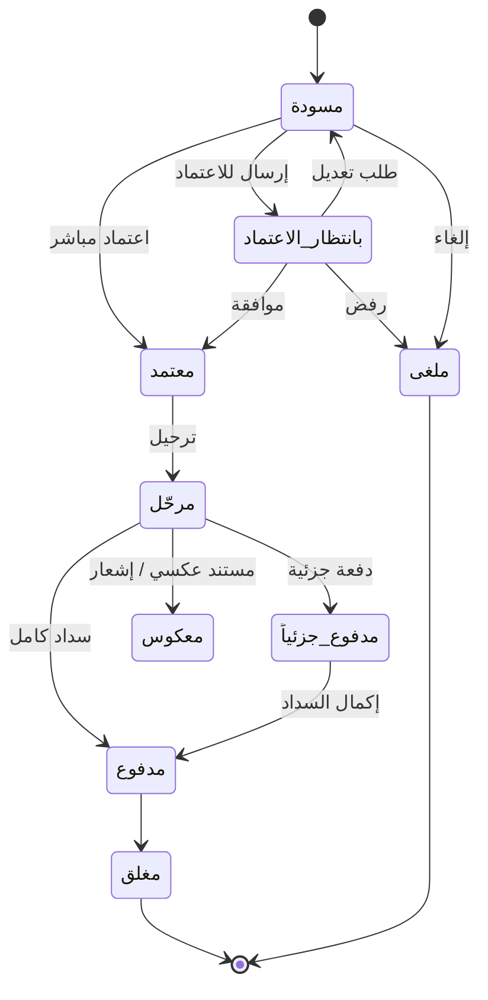

> المستند المرحّل لا يُعدَّل بما يمحو أثره؛ التصحيح بمستند عكسي أو إشعار.

## 6.9 المشتريات والموردون (P0/P1)

**المستندات:** طلب شراء، طلب عرض سعر، عرض مورد، أمر شراء، استلام بضاعة، فاتورة شراء (نقدية/آجلة)، مرتجع مشتريات، إشعارات، سند دفع.

**الوظائف:** ملف المورد وشروط الدفع، كتالوج وأسعار المورد، مقارنة العروض، اعتماد الطلبات، استلام جزئي/كلي، مطابقة (أمر/استلام/فاتورة)، فروقات وتالف، توزيع مصاريف الشراء والشحن (Landed Cost)، تحديث تكلفة المنتج، دفعات مقدمة، كشف حساب المورد، سجل مشتريات المنتج، بوابة المورد (P2).

## 6.10 العملاء (P0)

أفراد وشركات، مجموعات وشرائح ووسوم، عناوين وجهات اتصال متعددة، بيانات ضريبية، حد ائتماني، شروط سداد، مندوب مسؤول، كشف حساب، سجل تعاملات، رصيد مدين/دائن، تحليل أعمار، مرفقات وحقول مخصصة، تعليق التعامل، بوابة العميل (P2) لعرض الفواتير والأقساط وطلبات الدفع.

## 6.11 الديون والتحصيل (P0)

**ذمم مدينة:** بيع آجل، ربط بالفواتير، تحصيل كلي/جزئي، توزيع دفعة على عدة فواتير أو تخصيصها لفاتورة معينة، دفعات غير مخصصة، تسويات وخصومات سماح، شطب ديون، إعادة جدولة، حدود ائتمان وموافقة على التجاوز، أعمار الديون، تقارير المتأخرين.

**ذمم دائنة:** مستحقات الموردين، سداد جزئي، دفعات مقدمة، توزيع، كشوف، أعمار، جدولة مدفوعات.

**التحصيل:** سند قبض (وسيلة، صندوق/حساب، محصّل، تاريخ ومرجع)، إيصال، مطابقة الصندوق.

**قاعدة:** لا يُسجَّل التحصيل مرتين (Idempotency)، والحركات المالية سجلات غير قابلة للتعديل المباشر.

## 6.12 التقسيط (P0 أساسي / P1 متقدم)

**الخطط:** دفعة أولى + أقساط ثابتة، أقساط مخصصة/متغيرة، أسبوعي/شهري/ربع سنوي/تواريخ مخصصة، تسوية مبكرة، سداد جزئي، إعادة جدولة بموافقة، دفعة ختامية، تقسيط بلا فوائد، رسوم إضافية عند السماح القانوني.

**بيانات الخطة:** العميل، الفاتورة الأصلية، الإجمالي، الدفعة الأولى، الرصيد الممول، عدد الأقساط، قيمة القسط، تواريخ الاستحقاق، سياسة التأخير، المرفقات، الحالة.

**حالات القسط:**

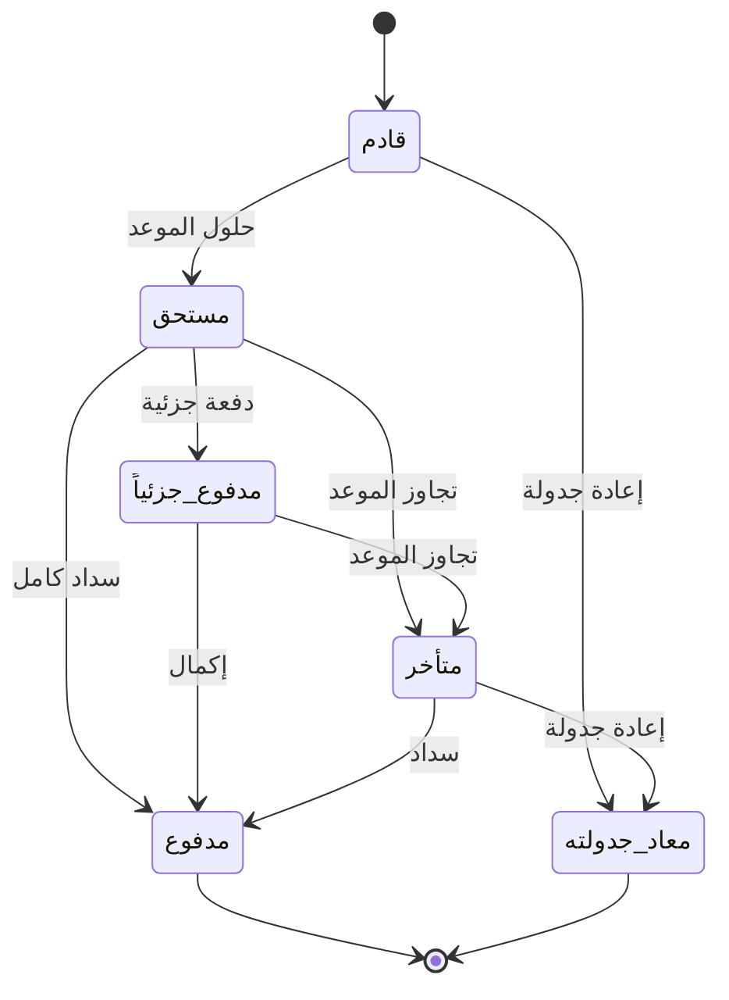

**قواعد**
- مجموع الدفعة الأولى والأقساط = المبلغ المستحق حسب العقد، وتُوزَّع فروقات التقريب بقاعدة معلنة.
- التمييز بين الأصل والرسوم والضرائب والخصومات والمحصّل.
- إعادة الجدولة لا تمحو الجدول السابق؛ يُحتفظ بالتاريخ والموافقة.
- لا يُفترض أن كل ترتيب مالي مسموح في كل ولاية قضائية؛ التحقق القانوني مطلوب.

## 6.13 الصناديق والبنوك والمصروفات (P0)

صناديق متعددة (فتح/إغلاق/قبض/صرف/تحويل/تسوية/جرد)، حسابات بنكية (إيداع/سحب/تحويل/تسوية بنكية/رسوم)، مصروفات وإيرادات بتصنيفات مخصصة ومرفقات ومراكز تكلفة واعتماد وتكرار دوري.

## 6.14 الخصومات والعروض والولاء (P1)

خصومات: ثابتة، نسبة، منتج، تصنيف، عميل، كمية، فترة زمنية، جملة. عروض: اشترِ X واحصل على Y، حزم، موسمية، شرائح كمية. كوبونات: فريدة/قابلة لإعادة الاستخدام، حدود، صلاحية، حد أدنى، لعميل محدد. ولاء: نقاط، مستويات، استبدال، بطاقات هدايا، رصيد مكافآت. تحديد أولوية تطبيق الخصومات ومنع التراكم غير المسموح، مع تسجيل السبب والجهة المعتمدة.

## 6.15 التوزيع والبيع الميداني (P1)

**العناصر:** مندوبون، سائقون، مركبات، مخزون مركبات، مناطق ومسارات، زيارات، توصيل، إثبات تسليم، عمولات.

**الوظائف:** تحميل وتفريغ المركبة، عهدة المندوب، طلبات ميدانية، Van Sales، فواتير وتحصيل ميداني، مرتجعات، خطط زيارات، تحسين المسارات، فشل التسليم وأسبابه، إثبات بالتوقيع/الصورة، حساب العمولات، تسوية السيارة والمندوب، تقارير الأداء.

**دون إنترنت:** تنزيل العملاء والمنتجات والأسعار المصرح بها، إنشاء الطلبات والفواتير والتحصيلات محلياً ومزامنتها لاحقاً.

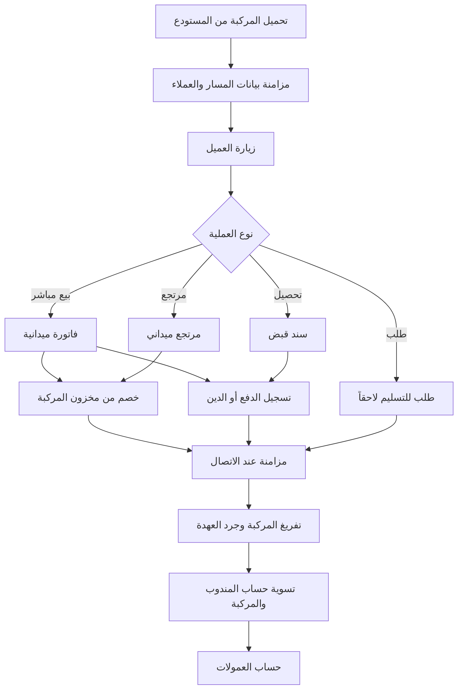

## 6.16 مصمم المستندات والملصقات (P1)

**الأنواع:** فواتير بيع/شراء/ضريبية/مبسطة/آجلة/تقسيط، عروض أسعار، أوامر، سندات قبض وصرف، إشعارات دائن/مدين، مرتجعات، إذن تسليم/استلام، تحويل مخزون، كشف حساب، جدول أقساط، ملصقات منتجات/أرفف/باركود، قسائم.

**المحرر:** سحب وإفلات، نصوص وصور وشعار، حقول ديناميكية، جداول أصناف، باركود وQR، خطوط وألوان ومحاذاة وهوامش، معاينة مباشرة، نسخ القوالب، قوالب حسب الفرع/نوع المستند، متعددة اللغات مع RTL.

**المقاسات:** A4، A5، حراري 58/80 مم، مقاسات مخصصة، ملصقات (عرض وارتفاع وفجوة الرول).

**الطباعة:** PDF، طباعة مباشرة، طوابير، اختيار طابعة، طابعات متعددة، طباعة تلقائية، عدد النسخ، سجل إعادة الطباعة، قص الورق وفتح الدرج.

## 6.17 التقارير والتحليلات (P0 أساسي / P1 متقدم)

| المجال | أمثلة |
|---|---|
| المبيعات | يومية/شهرية/سنوية، حسب المنتج/التصنيف/العميل/الفرع/الكاشير/المندوب/وسيلة الدفع، المرتجعات، هامش الربح |
| المخزون | الأرصدة، القيمة، الحركة، الجرد، الراكد، المنخفض، الصلاحية، الدوران، التقادم |
| المالية | الدخل، الميزانية، التدفقات، الذمم، أعمار الديون، التحصيلات، المصروفات، أداء التقسيط |
| التوزيع | عهد المركبات، أداء المسارات والمندوبين، نجاح التسليم، التحصيل، العمولات |
| التحليلات | مقارنة الفترات، الاتجاهات، KPIs، التنبؤ (P3)، منشئ تقارير مخصص |

التصدير: PDF، Excel، CSV، طباعة، تقارير مجدولة. كل التقارير تحترم الصلاحيات (بما فيها إخفاء التكلفة والربح).

## 6.18 الاستيراد والتصدير (P0/P1)

استيراد: منتجات، تصنيفات، عملاء، موردون، أرصدة افتتاحية، مخزون افتتاحي، قوائم أسعار، مستندات تاريخية.


يجب أن يعمل على دفعات مع حفظ التقدم وإدارة الذاكرة وإمكانية الاسترداد الآمن.

## 6.19 الإشعارات والأتمتة (P1)

تنبيهات: مخزون منخفض، قرب انتهاء، ديون متأخرة، أقساط قادمة/متأخرة، استحقاق موردين، موافقات معلقة، فشل مزامنة، إغلاق وردية، أحداث أمنية. القنوات: داخل التطبيق، إشعارات النظام، بريد، SMS، تكاملات. قواعد: تنبيه إعادة الطلب، تقارير مجدولة، تذكير بالدفع، حجز تلقائي، مسارات موافقات، مستندات متكررة، مشغلات أعمال مخصصة.

## 6.20 API والتكاملات (P1/P2)

REST API بإصدارات، Webhooks موقعة، مفاتيح API وOAuth، حدود طلبات، سجلات، إعادة محاولة، Idempotency Keys، تكامل مع بوابات الدفع والشحن والمتاجر الإلكترونية والرسائل والبريد وأنظمة محاسبة/ERP خارجية.

## 6.21 المرفقات والسجلات (P1)
إرفاق صور ووثائق بكل معاملة، تخزين محلي مع رفع تدريجي لتخزين الكائنات، تجزئة (Hash) للتحقق، أحجام قصوى وسياسات احتفاظ.

---

# 7. سير العمل الرئيسية

## 7.1 دورة البيع

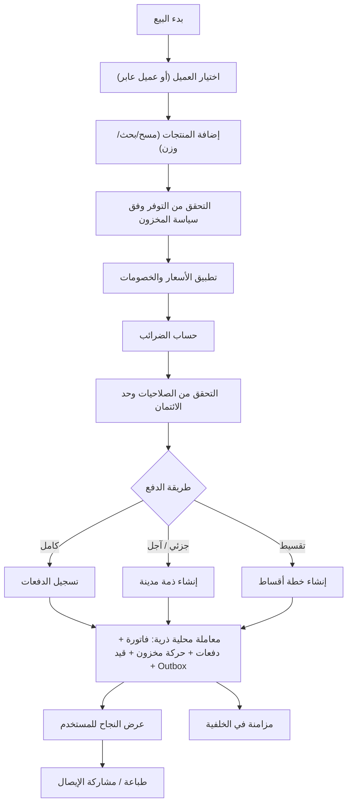

## 7.2 دورة المشتريات

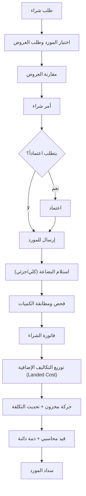

## 7.3 دورة التقسيط والتحصيل

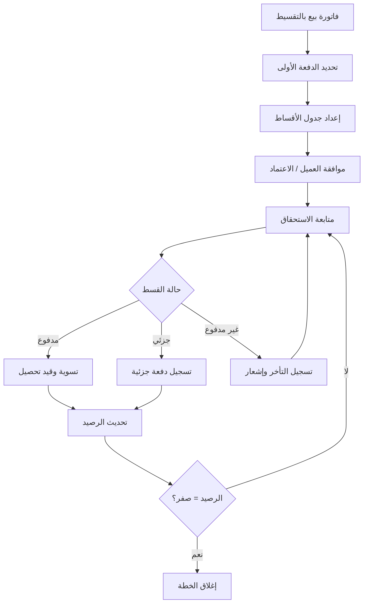

## 7.4 دورة التحويل المخزني

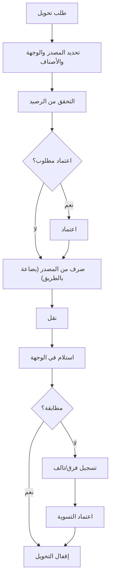

## 7.5 دورة المرتجع

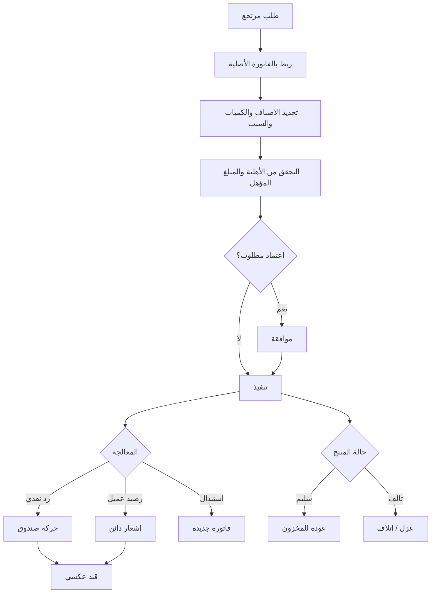

## 7.6 دورة الوردية

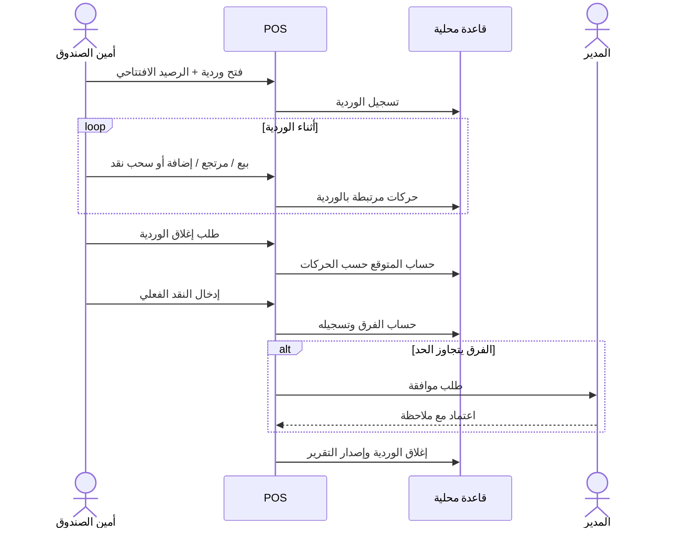

---

# 8. معمارية Local-First والمزامنة

## 8.1 المبادئ
- قاعدة البيانات المحلية مصدر التشغيل الفوري، وليست مجرد Cache.
- كل عملية حرجة تُنفَّذ في **معاملة ذرية** تشمل الأثر التجاري + الأثر المخزني + الأثر المحاسبي + حدث Outbox.
- الخادم مسؤول عن المزامنة والإدارة المركزية والمشاركة والنسخ والتقارير المركزية.
- المزامنة **على مستوى العمليات** (Operations/Events) وليست نسخ ملفات قاعدة البيانات أو استبدال بيانات جهاز بآخر.

## 8.2 مخطط المعمارية

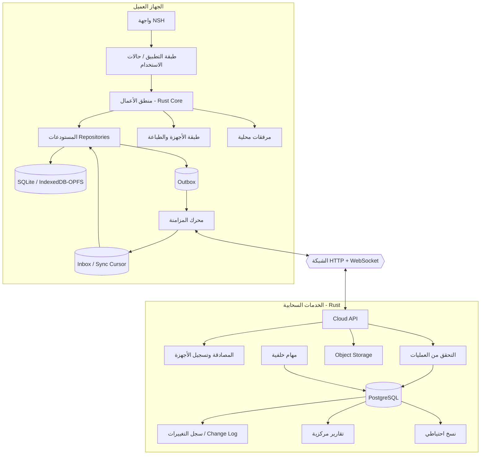

## 8.3 تسلسل المزامنة (رفع عملية)

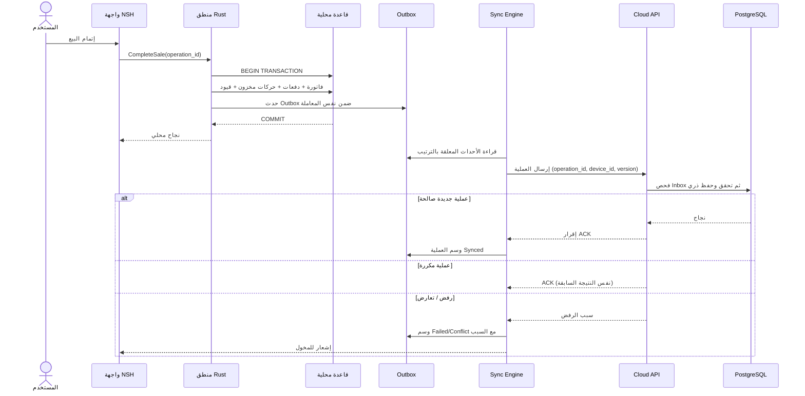

## 8.4 تنزيل التغييرات

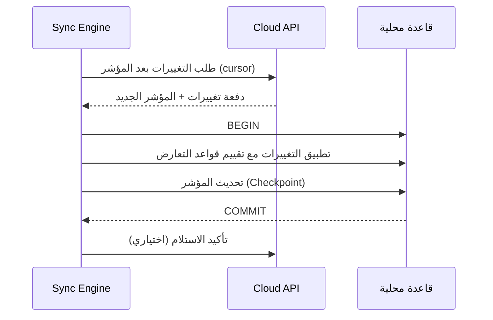

## 8.5 حالات الاتصال والمزامنة

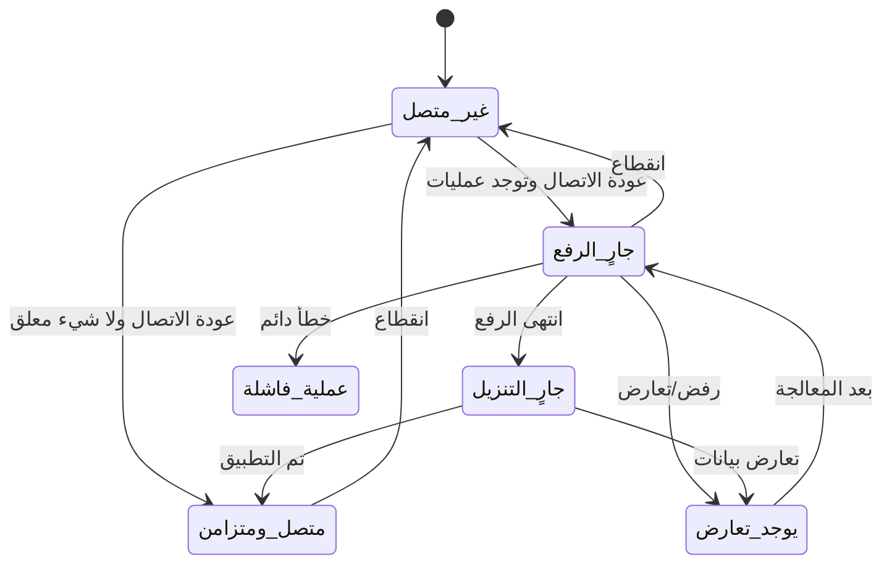

يجب أن تُعرض كل حالة بأيقونة ونص (لا اعتماداً على اللون وحده).

## 8.6 متطلبات المزامنة (P0)

- معرّف فريد عالمي لكل عملية (Operation ID) ولكل جهاز (Device ID).
- Outbox محلي دائم يُكتب ضمن المعاملة نفسها، وInbox/سجل استقبال على الخادم لمنع التكرار.
- مفاتيح Idempotency لكل طلب مالي.
- إعادة محاولة بتأخير تصاعدي (Exponential Backoff).
- مؤشرات تقدم ونقاط تحقق (Checkpoints).
- إصدار لكل كيان (Entity Version).
- مزامنة تلقائية ويدوية وخلفية حيث تسمح المنصة.
- رفع المرفقات الكبيرة على دفعات قابلة للاستئناف.
- عرض العمليات الفاشلة والتعارضات وتشخيصها.
- عدم حذف الحدث المحلي قبل إقرار موثوق.
- ضمان الترتيب السببي للعمليات المترابطة (فاتورة ثم دفعة عليها).
- الأرقام المسلسلة للمستندات تُدار بنطاقات لكل جهاز لتجنب التعارض دون اتصال.

## 8.7 سياسات حل التعارض

| نوع البيانات | السياسة |
|---|---|
| وصف المنتج، الصور | أحدث إصدار / دمج حقول آمن |
| بيانات اتصال العميل | دمج على مستوى الحقل عند عدم التعارض |
| المخزون | حركات غير قابلة للاستبدال (Append-only) |
| المدفوعات والتحصيل | معرفات فريدة، لا دمج صامت، لا إسقاط |
| القيود المحاسبية | سجلات مرحّلة غير قابلة للتعديل |
| الفواتير | حفظ هوية المستند وحالته، تعارض الحالة يُراجع |
| الإعدادات | إصدار صريح وموافقة |
| الصلاحيات | الخادم هو المرجع |
| مسودات المستندات | مقارنة إصدارات وحل يدوي عند الحاجة |

**قواعد حاسمة**
- لا تُستخدم Last-Write-Wins للمدفوعات أو القيود أو حركات المخزون.
- لا تُدمج عمليتان ماليتان متعارضتان آلياً.
- الرفض على الخادم لا يمحو الأثر المحلي؛ يُحفظ مع سبب الرفض وتُعرّف طريقة عكسه.
- تُعرض شاشة تعارض للمخول: القيم، المصدر، التوقيت، الجهاز.

## 8.8 تعدد الأجهزة والمخزون دون اتصال

لا يمكن ضمان أن رصيد جهاز غير متصل يمثل الرصيد العالمي. لذلك:

- يُميَّز بين **الرصيد المحلي** و**آخر رصيد مركزي مؤكد** و**العمليات المعلقة**.
- حد بيع دون اتصال لكل فرع/جهاز/منتج.
- حجز مسبق لمخزون جهاز أو مسار توزيع عند توفر الاتصال.
- عند التعارض (بيع نفس الكمية من جهازين): قبول مع تسجيل العجز، أو تعليق للمراجعة، أو منع البيع دون اتصال لمنتجات محددة حسب سياسة المؤسسة.
- لا يُعدَّل سجل تاريخي لإخفاء العجز.

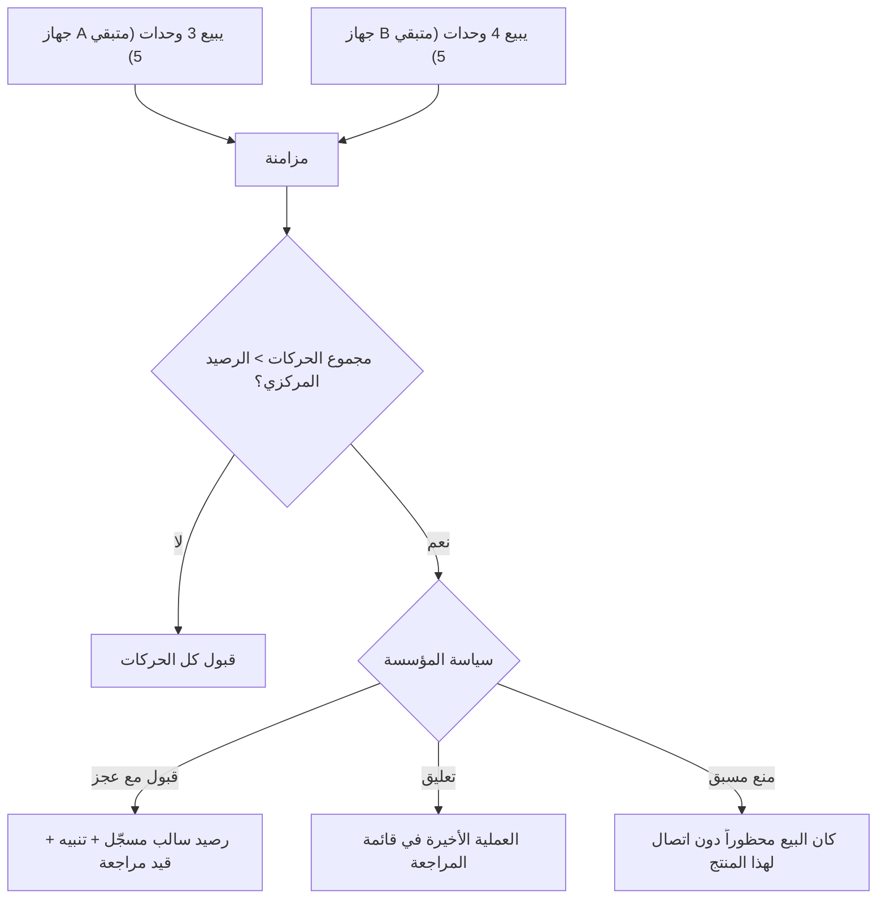

---

# 9. المعمارية التقنية (Rust + NSH)

## 9.1 المبادئ
- Rust لغة المنطق التجاري والطبقات الأساسية (عميل وخادم)، NSH لطبقة الواجهة متعددة المنصات.
- TSX اختياري فقط لأجزاء تحتاج تطويراً ديناميكياً سريعاً، وليس شرطاً معمارياً.
- مشاركة قواعد المجال بين المنصات، وفصل المحولات الخاصة بكل منصة.
- **الواجهة لا تحتوي قواعد مالية أو مخزنية جوهرية.**
- كل هدف بناء (Windows/macOS/Linux/Android/iOS/Web-WASM) يُختبر فعلياً قبل اعتماده.
- NSH لا يوفر نظام تصميم تجارياً جاهزاً؛ تُبنى مكتبة مكونات خاصة بالمشروع. التخزين المدمج في NSH مخصص للإعدادات الصغيرة (حد ~5MB وفق الوثائق) ولا يصلح للبيانات التشغيلية.

## 9.2 مخطط الطبقات

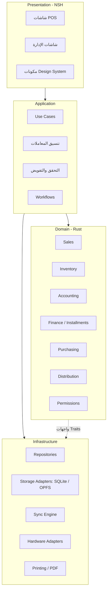

## 9.3 البنية المنطقية المقترحة للمستودع

```text
nsh-business/
├── apps/
│   ├── desktop/
│   ├── mobile/
│   └── web/
├── crates/
│   ├── core/            # أنواع مشتركة، Money، Quantity، IDs، Errors
│   ├── domain/          # الكيانات وقواعد المجال
│   ├── application/     # حالات الاستخدام
│   ├── database/        # المخطط، الترحيلات، المحولات
│   ├── sync/            # Outbox/Inbox/Conflicts
│   ├── accounting/
│   ├── inventory/
│   ├── sales/
│   ├── purchasing/
│   ├── finance/         # ديون، تقسيط، صناديق
│   ├── distribution/
│   ├── permissions/
│   ├── hardware/
│   ├── printing/
│   ├── documents/       # القوالب ومحرك PDF
│   ├── reporting/
│   ├── localization/
│   └── integrations/
├── server/
│   ├── api/
│   ├── auth/
│   ├── sync/
│   ├── jobs/
│   ├── reporting/
│   └── storage/
├── shared/
│   ├── contracts/       # عقود API والأحداث
│   ├── schemas/
│   └── i18n/
├── migrations/
└── tests/
    ├── unit/ integration/ sync/ accounting/ inventory/ cross-platform/
```

> تقسيم منطقي لا إلزامي؛ تُدمج الحزم عند عدم الحاجة مع الحفاظ على حدود قابلة للاختبار المستقل.

## 9.4 التقنيات

| الاستخدام | التقنية |
|---|---|
| منطق الأعمال | Rust |
| الواجهة | NSH |
| قاعدة محلية (Native) | SQLite |
| قاعدة محلية (Web) | IndexedDB أو SQLite-WASM + OPFS |
| قاعدة مركزية | PostgreSQL |
| API | خدمات Rust HTTP |
| الاتصال الفوري | WebSocket |
| بحث | SQLite FTS / PostgreSQL FTS |
| ملفات | Object Storage |
| مهام خلفية | Rust Workers |

## 9.5 الأنواع المالية
- المبالغ: أعداد صحيحة بأصغر وحدة نقدية أو Decimal دقيق؛ **ممنوع floating point**.
- دقة لكل عملة وسياسة تقريب معلنة.
- حفظ سعر الصرف ومصدره وتاريخه في المعاملات متعددة العملات.
- الكميات: Decimal بدقة وحدة القياس مع وحدة مرجعية.

## 9.6 مصادر الحقيقة

| الكيان | دوره |
|---|---|
| الفاتورة | مستند تجاري |
| الدفعة | حركة مالية مستقلة مرتبطة |
| القيد | الأثر المحاسبي |
| حركة المخزون | الأثر الكمي |
| رصيد العميل/المورد | إسقاط قابل لإعادة البناء |
| رصيد المخزون | إسقاط من الحركات |

## 9.7 خدمات الخادم
المصادقة والمؤسسات والأجهزة، استقبال المزامنة والتحقق، الملفات والمرفقات، التقارير المركزية، المهام الخلفية (تنبيهات، تقارير مجدولة)، النسخ الاحتياطي، مراقبة وسجلات، الاشتراكات (عند SaaS).

## 9.8 تعدد المؤسسات على الخادم (قرار مفتوح)
خيارات: قاعدة مشتركة بعزل صفوف (tenant_id + RLS)، مخطط لكل مؤسسة، قاعدة لكل مؤسسة، أو هجين. يُحسم بحسب حجم العملاء ومتطلبات العزل والتكلفة.

---

# 10. نموذج البيانات

## 10.1 قواعد التصميم
- معرّفات عالمية فريدة (UUID v7 أو مماثل) للكيانات التي تُنشأ دون اتصال.
- `organization_id` لكل سجل تابع، و`branch_id`/`warehouse_id` عند الحاجة.
- حقول مشتركة: created_at، updated_at، created_by، updated_by، source_device_id، version، sync_status (محلياً)، deleted_at (حذف منطقي حيث يناسب).
- المبالغ والكميات بأنواع دقيقة.
- مفاتيح أجنبية وقيود CHECK وفهارس مدروسة.
- فصل المستندات عن سجلات الأحداث والحركات.
- السجلات المالية والمخزنية **Append-only**.
- لا اعتماد على أرقام تسلسلية محلية كمعرّف عالمي.

## 10.2 الكيانات حسب النطاق

| النطاق | الكيانات |
|---|---|
| الهوية والمؤسسة | Organization, LegalEntity, Branch, Warehouse, WarehouseLocation, User, Role, Permission, UserRole, Device, Session, BusinessProfile, FeatureToggle |
| المنتجات | Product, ProductVariant, Category, Brand, Attribute, ProductAttribute, Barcode, Unit, UnitConversion, PriceList, ProductPrice, PriceHistory, ProductImage, Batch, SerialNumber |
| المبيعات | Cart, Quotation, SalesOrder, SalesInvoice, SalesInvoiceLine, SalesReturn, SalesReturnLine, Discount, Promotion, Coupon, GiftCard, LoyaltyAccount, CashRegister, CashSession |
| المشتريات | Supplier, PurchaseRequest, PurchaseOrder, GoodsReceipt, PurchaseInvoice, PurchaseInvoiceLine, PurchaseReturn, LandedCost |
| المخزون | StockMovement, StockBalanceProjection, StockReservation, StockTransfer, StockAdjustment, StockCount, StockCountLine, InventoryValuationLayer |
| المالية | Customer, Supplier(Account), CustomerAccount, Payment, PaymentAllocation, Receivable, Payable, InstallmentPlan, Installment, Expense, Income, CashAccount, BankAccount |
| المحاسبة | Account, FiscalYear, FiscalPeriod, JournalEntry, JournalLine, CostCenter, TaxCode, ExchangeRate, FixedAsset, DepreciationRecord, AccountingRule |
| التوزيع | SalesRepresentative, Driver, Vehicle, VehicleStock, Route, Visit, Delivery, DeliveryLine, ProofOfDelivery, Commission |
| المزامنة | DeviceOperation, OutboxEvent, InboxEvent, SyncCursor, SyncCheckpoint, EntityVersion, Conflict, SyncFailure, SyncAttempt |
| النظام | AuditLog, Attachment, DocumentTemplate, DocumentSequence, Notification, ApprovalRequest, ImportJob |

## 10.3 مخطط العلاقات المفاهيمي

```mermaid
erDiagram
    ORGANIZATION ||--o{ BRANCH : owns
    ORGANIZATION ||--o{ USER : employs
    ORGANIZATION ||--o{ DEVICE : authorizes
    BRANCH ||--o{ WAREHOUSE : contains
    BRANCH ||--o{ CASH_REGISTER : operates
    CASH_REGISTER ||--o{ CASH_SESSION : opens
    USER }o--o{ ROLE : assigned
    ROLE }o--o{ PERMISSION : grants

    PRODUCT ||--o{ PRODUCT_VARIANT : has
    PRODUCT ||--o{ BARCODE : identified_by
    PRODUCT }o--|| CATEGORY : in
    PRODUCT }o--|| UNIT : base_unit
    UNIT ||--o{ UNIT_CONVERSION : converts
    PRODUCT ||--o{ PRODUCT_PRICE : priced
    PRICE_LIST ||--o{ PRODUCT_PRICE : contains

    WAREHOUSE ||--o{ STOCK_MOVEMENT : records
    PRODUCT ||--o{ STOCK_MOVEMENT : moves
    PRODUCT ||--o{ BATCH : tracked_in
    PRODUCT ||--o{ SERIAL_NUMBER : tracked_as
    STOCK_TRANSFER ||--o{ STOCK_MOVEMENT : generates

    CUSTOMER ||--o{ SALES_INVOICE : receives
    SALES_INVOICE ||--|{ SALES_INVOICE_LINE : contains
    PRODUCT ||--o{ SALES_INVOICE_LINE : sold_as
    SALES_INVOICE ||--o{ STOCK_MOVEMENT : issues
    SALES_INVOICE ||--o{ PAYMENT_ALLOCATION : settled_by
    PAYMENT ||--o{ PAYMENT_ALLOCATION : allocates
    SALES_INVOICE ||--o{ SALES_RETURN : returned_by

    SUPPLIER ||--o{ PURCHASE_ORDER : receives
    PURCHASE_ORDER ||--o{ GOODS_RECEIPT : fulfilled_by
    SUPPLIER ||--o{ PURCHASE_INVOICE : bills
    PURCHASE_INVOICE ||--|{ PURCHASE_INVOICE_LINE : contains

    CUSTOMER ||--o{ INSTALLMENT_PLAN : has
    INSTALLMENT_PLAN ||--|{ INSTALLMENT : schedules
    INSTALLMENT ||--o{ PAYMENT_ALLOCATION : settled_by

    JOURNAL_ENTRY ||--|{ JOURNAL_LINE : contains
    ACCOUNT ||--o{ JOURNAL_LINE : posted_to
    FISCAL_PERIOD ||--o{ JOURNAL_ENTRY : groups

    DEVICE ||--o{ OUTBOX_EVENT : creates
    SALES_REP ||--o{ VEHICLE : drives
    VEHICLE ||--o{ VEHICLE_STOCK : holds
    ROUTE ||--o{ VISIT : schedules
```

> مخطط مفاهيمي. يلزم ERD تفصيلي لكل نطاق مع المفاتيح والقيود وأنواع البيانات والفهارس (Database Design Document).

## 10.4 قواعد مالية على البيانات
- كل فاتورة: بنود ومجاميع محفوظة (لا تُشتق ديناميكياً من أسعار حالية).
- كل دفعة: وسيلة وحساب مستلم ومعرّف فريد.
- توزيع الدفعة على الفواتير/الأقساط عبر `PaymentAllocation`.
- الرصيد المستحق = إجمالي المستند ± إشعارات − مخصصات الدفعات − تسويات.
- كل قيد مرحّل متوازن.
- كل حركة مخزون: كمية، وحدة مرجعية، مستودع، مصدر (مستند)، دفعة/تسلسل عند الحاجة.
- تكرار حدث مزامنة لا يكرر أي أثر.

---

# 11. المحاسبة وربطها بالعمليات

## 11.1 المكونات
دليل حسابات هرمي (أصول، التزامات، حقوق ملكية، إيرادات، مصروفات، تكلفة مبيعات)، مراكز تكلفة وأبعاد تحليلية، قيود آلية ويدوية وعكسية وإقفال، دفتر أستاذ عام وفرعي (عملاء/موردون)، أرصدة افتتاحية، فترات وسنوات مالية، تعدد العملات وفروق الصرف، ضرائب، أصول ثابتة وإهلاك، استحقاقات ومدفوعات مقدمة، محاسبة المخزون وتكلفة البضاعة المباعة.

## 11.2 تدفق القيد المحاسبي

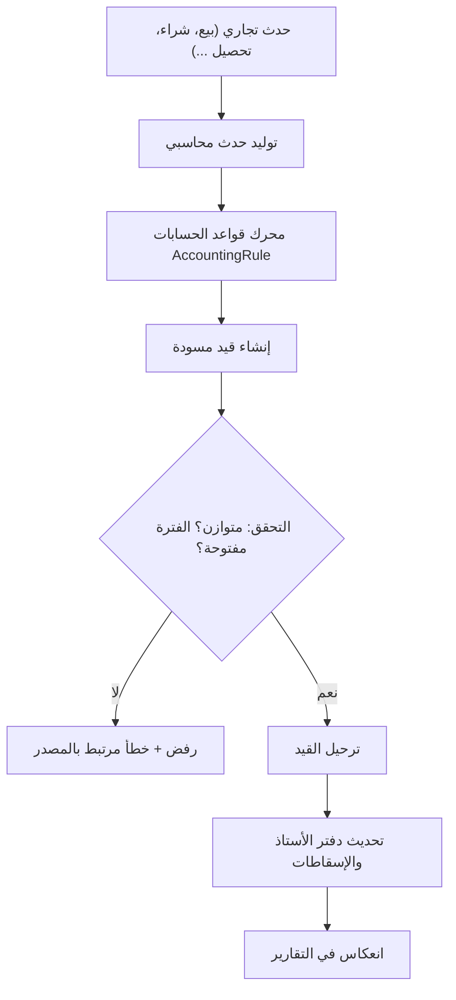

## 11.3 أمثلة على القيود الآلية (إرشادية؛ تُضبط حسب المؤسسة والدولة)

| العملية | مدين | دائن |
|---|---|---|
| بيع نقدي | الصندوق | المبيعات + ضريبة المخرجات |
| بيع آجل | ذمم العملاء | المبيعات + ضريبة المخرجات |
| تكلفة البضاعة المباعة | تكلفة المبيعات | المخزون |
| تحصيل من عميل | الصندوق/البنك | ذمم العملاء |
| شراء آجل | المخزون + ضريبة المدخلات | ذمم الموردين |
| سداد مورد | ذمم الموردين | الصندوق/البنك |
| مرتجع مبيعات | مردودات المبيعات + ضريبة | الصندوق/ذمم العملاء |
| إعادة المخزون للمرتجع | المخزون | تكلفة المبيعات |
| عجز جرد | خسائر المخزون | المخزون |
| عجز الصندوق | فروق الصندوق | الصندوق |

## 11.4 ضوابط إلزامية (P0)
- مجموع المدين = مجموع الدائن لكل قيد مرحّل.
- لا حذف للقيود المرحّلة؛ التصحيح بقيد عكسي/تسوية.
- حماية الفترات المغلقة.
- ربط كل قيد بمستند المصدر وبمنفذه.
- التقارير قابلة لإعادة الإنتاج من السجلات.
- سياسة تقريب موحدة ومعلنة.
- إعادة بناء الأرصدة من السجلات ممكنة دائماً.

---

# 12. الصلاحيات والموافقات

## 12.1 النموذج
RBAC مع نطاقات: المؤسسة، الكيان القانوني، الفرع، المستودع، الصندوق/نقطة البيع، السجل/المستند، الحقل، الإجراء الحساس.

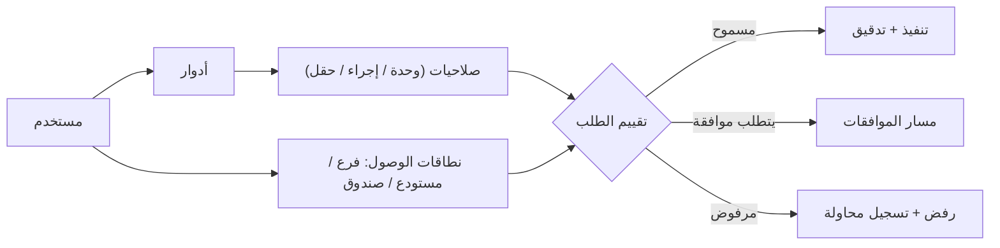

## 12.2 العمليات الحساسة (تتطلب صلاحية + تدقيق)
تعديل الأسعار، خصم استثنائي، البيع بأقل من الحد/بخسارة، حذف مسودات، اعتماد مرتجع، تسوية مخزون، تجاوز حد الائتمان، اعتماد أمر شراء، تعديل/ترحيل قيود، إقفال فترة، إدارة المستخدمين، عرض التكلفة والأرباح، إعادة جدولة تقسيط.

## 12.3 مسار الموافقات

```mermaid
flowchart TD
    A["إنشاء عملية"] --> B["تقييم قواعد الموافقة (النوع/القيمة/الفرع/الدور)"]
    B --> C{"تتطلب موافقة؟"}
    C -->|"لا"| D["تنفيذ"]
    C -->|"نعم"| E["قائمة الموافقات + إشعار"]
    E --> F["المراجع المخوّل"]
    F --> G{"القرار"}
    G -->|"اعتماد"| D
    G -->|"رفض"| H["رفض مع سبب"]
    G -->|"طلب تعديل"| I["إعادة للمنشئ"]
    I --> A
```

**موافقات دون اتصال:** تُعرَّف سياسة صريحة: رمز موافقة مشرف (PIN/بطاقة) محلي محدود الصلاحية يُسجَّل ويُراجَع عند المزامنة، أو منع العملية حتى الاتصال.

---

# 13. تجربة المستخدم والتصميم

## 13.1 الرؤية
تجربة تجمع كفاءة أنظمة POS الاحترافية ووضوح تطبيقات SaaS الحديثة، وليست واجهة ERP تقليدية مزدحمة بالجداول.

## 13.2 المبادئ
بساطة وتسلسل معلومات واضح، اتساق المكونات، تنقل سريع، إجراءات سياقية، كثافة معلومات مناسبة لسطح المكتب، عناصر لمسية كبيرة للجوال، تباين وإتاحة، حالات تحميل (Skeleton)/فراغ/خطأ/نجاح، Undo حيث يكون آمناً، تخصيص الأعمدة والفلاتر.

## 13.3 تجربة كل منصة

| المنصة | العناصر |
|---|---|
| سطح المكتب | قائمة جانبية قابلة للطي، جداول كثيفة بأعمدة مثبتة، نوافذ ولوحات متعددة، اختصارات، Command Palette، قوائم سياقية، إجراءات جماعية، لوحات قابلة لتغيير الحجم |
| الجوال | تنقل سفلي، إجراءات سريعة، نماذج مبسطة، ماسح بالكاميرا، POS جوال، بيع ميداني، تحصيل، مؤشرات Offline، تشغيل بيد واحدة |
| التابلت | تخطيط POS مُحسَّن، عرض منقسم (Split View)، جداول لمسية، عمليات مستودع |
| الويب | لوحة تحكم، إدارة مركزية، تقارير، فروع ومستخدمون، منتجات، مستندات |

## 13.4 خريطة التنقل المقترحة

```mermaid
flowchart TB
    HOME["الرئيسية / لوحة التحكم"] --> POS["نقطة البيع"]
    HOME --> SALES["المبيعات"]
    HOME --> PUR["المشتريات"]
    HOME --> INV["المخزون"]
    HOME --> PRD["المنتجات"]
    HOME --> CUS["العملاء والموردون"]
    HOME --> FIN["المالية"]
    HOME --> ACC["المحاسبة"]
    HOME --> DST["التوزيع"]
    HOME --> RPT["التقارير"]
    HOME --> SET["الإعدادات"]

    SALES --> S1["الفواتير"]
    SALES --> S2["عروض الأسعار والطلبات"]
    SALES --> S3["المرتجعات"]
    SALES --> S4["العروض والولاء"]
    INV --> I1["الأرصدة"]
    INV --> I2["الحركات"]
    INV --> I3["التحويلات"]
    INV --> I4["الجرد"]
    FIN --> F1["الديون والتحصيل"]
    FIN --> F2["التقسيط"]
    FIN --> F3["الصناديق والبنوك"]
    FIN --> F4["المصروفات"]
    SET --> T1["المؤسسة والفروع"]
    SET --> T2["المستخدمون والصلاحيات"]
    SET --> T3["المستندات والقوالب"]
    SET --> T4["الأجهزة"]
    SET --> T5["المزامنة والنسخ"]
```

## 13.5 شاشة POS
شاشة مخصصة منفصلة عن صفحات الإدارة، مقسمة إلى: البحث/المسح، التصنيفات والمنتجات، السلة، العميل، الخصومات والضرائب، الإجمالي، الدفع. على الشاشات الصغيرة تتحول المناطق إلى لوحات/خطوات مع بقاء السلة والإجمالي في متناول اليد. الأفعال الحرجة بأقل تفاعل ممكن، مع وضع Quick Sale.

## 13.6 نظام التصميم (Design System)
ألوان دلالية (نجاح/تحذير/خطأ/معلومة)، خطوط عربية واضحة، مسافات، حدود وظلال، أيقونات، أزرار، حقول، قوائم منسدلة، نوافذ، أدراج جانبية، قوائم، تبويبات، جداول، بطاقات، مخططات، نماذج، إشعارات غير مزعجة، حالات تحميل وفراغ وخطأ، قواعد RTL.

## 13.7 اللغات والثيمات
- ثيمات: فاتح، داكن، نظام.
- العربية RTL، الإنجليزية، الفرنسية، قابل لإضافة لغات.
- RTL يؤثر على التنقل والمحاذاة والأيقونات الاتجاهية والجداول والنماذج ومستندات الطباعة.
- تنسيق التواريخ والأرقام والعملات حسب الإعداد، ودعم النصوص ثنائية الاتجاه المختلطة، وأنظمة تقويم مختلفة.
- لا نصوص مضمنة في الشيفرة بلا نظام ترجمة.

## 13.8 البحث العام والاختصارات
بحث موحد (منتجات، عملاء، موردون، فواتير، طلبات، باركود، هواتف، مراجع) يحترم الصلاحيات؛ Command Palette؛ اختصارات لوحة المفاتيح قابلة للتخصيص.

---

# 14. التخصيص حسب النشاط التجاري

## 14.1 ملفات الأنشطة الجاهزة

| النشاط | الخصائص المفعّلة |
|---|---|
| سوبرماركت / بقالة | ميزان، باركود موزون، ملصقات، عبوات، صلاحية، POS سريع، عروض |
| ملابس وأحذية | ألوان ومقاسات، متغيرات، باركود لكل متغير، استبدال، مواسم |
| إلكترونيات | أرقام تسلسلية، ضمان، ملحقات، تتبع المورد |
| قطع غيار | توافق المركبات، أرقام OEM، بدائل |
| جملة / توزيع | قوائم أسعار، حدود ائتمان، مندوبون، مركبات، مسارات، تحصيل ميداني |
| مطاعم ومقاهي | قوائم، إضافات، طاولات، مطبخ، تقسيم الحساب |
| مواد بناء | وحدات القياس والتحويل، كميات كسرية، نقل وتوصيل |
| صيدليات | دفعات، صلاحية، متطلبات امتثال خاصة |
| تجارة عامة | مبيعات ومشتريات قياسية |

## 14.2 آليات التخصيص
Feature Toggles، حقول مخصصة، وحدات مخصصة، سير عمل مخصص، قوالب مستندات مخصصة، قواعد أعمال مخصصة، تنقل وشاشات حسب الدور والنشاط (Progressive Disclosure).

```mermaid
flowchart LR
    A["إنشاء مؤسسة"] --> B["اختيار النشاط"]
    B --> C["تحميل ملف النشاط (Profile)"]
    C --> D["تفعيل الوحدات المناسبة"]
    C --> E["ضبط السياسات الافتراضية"]
    C --> F["قوالب مستندات ودليل حسابات مقترح"]
    D --> G["تخصيص لاحق من الإعدادات"]
    E --> G
    F --> G
```

**مبدأ:** لا نسخة مختلفة من البرنامج لكل نشاط؛ بل وحدات مشتركة وإعدادات، مع إبقاء قواعد المجال الأساسية موحدة.

---

# 15. الأجهزة الخارجية (Hardware Abstraction Layer)

## 15.1 الأجهزة وطرق الاتصال

| الجهاز | الاتصال المحتمل |
|---|---|
| قارئ باركود | USB HID / Bluetooth / كاميرا |
| طابعة حرارية | ESC/POS عبر USB / Network / Bluetooth |
| طابعة ملصقات | TSPL / ZPL / ESC/POS حسب الجهاز |
| ميزان إلكتروني | Serial / USB / TCP / Bluetooth |
| درج النقد | عبر الطابعة أو منفذ مخصص |
| شاشة العميل | USB / Serial / Network |
| طرفية دفع | API / SDK للمصنّع |
| RFID | USB / Bluetooth |
| كاميرا | واجهة النظام الأصلية |

## 15.2 التصميم

```mermaid
flowchart TB
    APP["منطق التطبيق"] --> HAL["واجهات موحدة (Traits)"]
    HAL --> PS["PrinterService"]
    HAL --> SS["ScaleService"]
    HAL --> BS["BarcodeService"]
    HAL --> CD["CashDrawerService"]
    HAL --> DS["CustomerDisplayService"]
    HAL --> PT["PaymentTerminalService"]
    PS --> D1["Driver: ESC/POS"]
    PS --> D2["Driver: TSPL / ZPL"]
    SS --> D3["Driver: ميزان طراز A"]
    SS --> D4["Driver: ميزان طراز B"]
    D1 --> T1["Transport: USB / TCP / BT"]
    D3 --> T2["Transport: Serial / TCP"]
    WEB["الويب"] -. "قيود المتصفح" .-> BR["Local Hardware Bridge"]
    BR --> HAL
```

**المتطلبات:** اكتشاف حيث يتاح، ملفات تعريف الأجهزة، اختبار الاتصال، إعادة الاتصال، سجلات الاتصال والأخطاء، إعدادات لكل جهاز، تعريفات مستقلة لكل مصنّع دون تعديل نظام المبيعات.

**قيد المنصة:** الويب لا يضمن نفس صلاحيات سطح المكتب (USB/Serial/Bluetooth/الطباعة المباشرة)؛ قد يلزم تطبيق وسيط محلي. على Android/iOS تُختبر قيود USB وBluetooth لكل جهاز. توفير مصفوفة توافق (Hardware Compatibility Matrix) وعدم الادعاء بدعم غير مُختبر.

---

# 16. الأمان

## 16.1 المصادقة
تسجيل دخول آمن، سياسات كلمات المرور، إدارة الجلسات، مصادقة متعددة العوامل، تسجيل الأجهزة وإلغاؤها، استعادة الحساب، بصمة/وجه اختياري، سجل محاولات الدخول.

## 16.2 التفويض
RBAC، صلاحيات دقيقة، عزل المؤسسات، قيود الفروع والمستودعات، تفويض الإجراءات الحساسة. الخادم هو المرجع للصلاحيات.

## 16.3 حماية البيانات
تشفير الاتصال (TLS)، تشفير النسخ الاحتياطية، تخزين آمن لبيانات الاعتماد والرموز في مخزن المنصة الآمن (Keychain/Keystore/DPAPI)، حماية قاعدة البيانات المحلية (تشفير مثل SQLCipher وفق قدرات المنصة)، حماية ضد الوصول غير المصرح للجهاز، عزل بيانات المؤسسات.

## 16.4 سجل التدقيق (Audit Log)
يسجل: الدخول، إجراءات المستخدم، تغييرات الأسعار، الخصومات، تسويات المخزون، الدفعات، المرتجعات، التعديلات المالية، تغييرات الصلاحيات، الموافقات، عمليات الأجهزة. السجلات مقاومة للتلاعب (تسلسل تجزئة Hash Chain أو ما يماثله).

## 16.5 الأمان دون اتصال
سياسات مصادقة محلية، تشفير البيانات الحساسة، سياسات إلغاء الجهاز (Remote Revoke عند الاتصال + انتهاء صلاحية جلسة محلية)، التحقق من الصلاحيات محلياً، حماية العمليات غير المتزامنة، بيانات اعتماد المزامنة محمية. تُحدَّد سياسات التفويض دون اتصال للعمليات الحساسة بوضوح.

## 16.6 أمان API
مفاتيح API وOAuth، حدود الطلبات، توقيع Webhooks، سجلات الطلبات، إصدار، حماية من إعادة التشغيل (Replay) عبر Idempotency وNonce.

---

# 17. المتطلبات غير الوظيفية

## 17.1 الأداء (أهداف أولية تُقاس على أجهزة مرجعية وبيانات واقعية)

| العملية | الهدف الأولي |
|---|---|
| بدء التطبيق | أقل من 3 ثوانٍ |
| بحث محلي عن منتج | أقل من 150 مللي ثانية |
| حفظ فاتورة محلية | أقل من 200 مللي ثانية |
| التنقل المعتاد | أقل من 100 مللي ثانية |
| إضافة منتج للسلة | استجابة بصرية فورية |
| لوحة التحكم المحلية | عرض تدريجي |
| المزامنة | في الخلفية دون تعطيل |

تُحدَّد مجموعة بيانات مرجعية (مثلاً 100 ألف منتج، ملايين الحركات) واختبارات أداء قابلة للتكرار على أجهزة منخفضة الموارد قبل اعتماد الأرقام النهائية.

## 17.2 الاعتمادية
معاملات ذرية، استعادة بعد إغلاق مفاجئ (WAL)، عدم فقد العمليات المحلية، منع التكرار، فحص سلامة القاعدة، نسخ قابلة للاستعادة، معالجة امتلاء التخزين، تعافٍ من الأخطاء.

## 17.3 التوافر
يُقاس توافر السحابة وتوافر التشغيل المحلي بشكل منفصل. انقطاع السحابة لا يوقف POS المحلي.

## 17.4 قابلية التوسع
نمو في المؤسسات والفروع والمستخدمين والأجهزة والمنتجات والمستندات والحركات والقيود دون إعادة تصميم؛ تجنب أي افتراض يقيّد النظام بمتجر أو صندوق واحد.

## 17.5 الصيانة
حدود وحدات واضحة، واجهات موثقة، اختبارات وحدة وتكامل، ترحيلات قاعدة بيانات، إصدارات API، سجلات منظمة، مراقبة أخطاء، توثيق قرارات المعمارية (ADR).

## 17.6 الإتاحة وسهولة الاستخدام
دعم لوحة المفاتيح، قارئات الشاشة حيث تدعم المنصة، تسميات واضحة، تباين عالٍ، نصوص قابلة للتكبير، رسائل تحقق واضحة، عدم الاعتماد على اللون وحده.

## 17.7 التوافق والتحديثات
ترقيات تطبيق متوافقة مع المخطط، ترحيل قاعدة البيانات المحلية مع نسخة احتياطية تلقائية قبل الترحيل، توافق رجعي بين إصدارات التطبيق والخادم ضمن نافذة معلنة، منع المزامنة من إصدار قديم غير مدعوم برسالة واضحة.

---

# 18. التوطين والامتثال

لا تُضمَّن قواعد ضريبة أو مالية لدولة واحدة داخل النواة؛ تُستخدم **حزم توطين (Localization Packs)** تحدد: العملة ودقتها، الضرائب والمعرفات الضريبية، متطلبات الفاتورة، الترقيم المالي، الأعراف المحاسبية، الفوترة الإلكترونية، الدفع، التقويم وتنسيق التاريخ.

حزمة الجزائر مرشحة مبدئية (DZD، ضريبة TVA وفق الإعداد، اتفاقيات الفواتير المحلية). **يجب مراجعة التشريعات النافذة قبل الاستخدام الإنتاجي** (بما في ذلك متطلبات الفوترة والأرشفة والتقسيط).

---

# 19. النسخ الاحتياطي والاستعادة

نسخ محلية مجدولة ومشفرة، نسخ سحابية مشفرة، نسخ يدوية، نقاط استعادة، سياسة احتفاظ، تحقق من سلامة النسخة، اختبار استعادة دوري، استعادة جهاز جديد من نسخة/خادم، استعادة المرفقات، سجل العمليات، حماية من الوصول غير المصرح، تصدير انتقائي، خطة تعافٍ من الكوارث. تُعرَّف أهداف RPO وRTO لكل نموذج نشر وتُختبر عملياً.

```mermaid
flowchart LR
    A["قاعدة محلية"] --> B["لقطة متسقة (Snapshot)"]
    B --> C["ضغط وتشفير"]
    C --> D["تخزين محلي / USB"]
    C --> E["رفع سحابي"]
    D --> F["تحقق من السلامة (Checksum + فتح تجريبي)"]
    E --> F
    F --> G["سجل النسخ"]
    H["استعادة"] --> I["اختيار نقطة استعادة"]
    I --> J["فك التشفير والتحقق"]
    J --> K["استبدال القاعدة + إعادة بناء الإسقاطات"]
    K --> L["إعادة مزامنة من آخر Checkpoint"]
```

---

# 20. الاختبارات ومعايير القبول

## 20.1 مستويات الاختبار
وحدة، تكامل، خصائص (Property-based) للحسابات المالية والمخزنية، محاكاة المزامنة وتعدد الأجهزة (Deterministic Simulation)، أداء، أمان، قبول، منصات، أجهزة.

## 20.2 اختبارات Local-First
قطع الإنترنت أثناء البيع، إعادة تشغيل دون اتصال، عدة عمليات، إعادة الاتصال والمزامنة، عدم التكرار وعدم فقد الدفعات، اتساق المخزون، رفض عملية من الخادم، فشل منتصف المعاملة (قطع الطاقة)، امتلاء التخزين.

## 20.3 اختبارات تعدد الأجهزة
بيع المنتج نفسه من جهازين، تحصيلان متزامنان، تعديل بيانات العميل من جهازين، نقل مخزون أثناء البيع، عكس مستند مع تغييرات معلقة، إعادة إرسال الحدث نفسه مرات، تغيّر الساعة (Clock Skew) بين الأجهزة.

## 20.4 اختبارات مالية ومحاسبية
توازن القيود، توزيع الدفعات، أرصدة العملاء والموردين، حسابات الأقساط والتقريب، تقييم المخزون، حساب الأرباح، إقفال الفترات، تحويل العملات، إعادة بناء الأرصدة من السجلات ومطابقتها بالإسقاطات.

## 20.5 اختبارات المنصات
Windows، macOS، Linux، Android، iOS، Web: التخزين، الطباعة، الماسح، الكاميرا، الصلاحيات، العمل الخلفي، انقطاع الاتصال، RTL والعربية.

## 20.6 معايير القبول الجوهرية

- [ ] البيع دون إنترنت وإعادة المزامنة دون فقد.
- [ ] عدة كاشيرات في الوقت نفسه.
- [ ] لا تكرار للمدفوعات عند انقطاع الشبكة.
- [ ] تطابق المخزون بين الأجهزة بعد المزامنة.
- [ ] معالجة بيع الكمية نفسها من جهازين.
- [ ] استعادة البيانات من النسخ الاحتياطية.
- [ ] صحة الحسابات والقيود (صفر قيود غير متوازنة).
- [ ] عمل الطباعة والميزان على الأجهزة المستهدفة.
- [ ] العربية وRTL على كل المنصات.

---

# 21. خارطة الطريق وتعريف MVP

```mermaid
flowchart LR
    P0["المرحلة 0\nSpikes تقنية"] --> P1["المرحلة 1\nالأساس"]
    P1 --> P2["المرحلة 2\nالمنتجات والمخزون"]
    P2 --> P3["المرحلة 3\nPOS والمبيعات"]
    P3 --> P4["المرحلة 4\nالعملاء والمالية والتقسيط"]
    P4 --> P5["المرحلة 5\nالمحاسبة الكاملة"]
    P5 --> P6["المرحلة 6\nالمشتريات والتوزيع"]
    P6 --> P7["المرحلة 7\nالمستندات والتقارير والتكامل"]
    P7 --> P8["المرحلة 8\nالبوابات والأتمتة والتحليلات"]
    P8 --> P9["المرحلة 9\nالتنبؤ والذكاء والإضافات"]
```

| المرحلة | النطاق | الأولوية |
|---|---|---|
| 0 | تجارب إثبات المفهوم: NSH على كل المنصات، SQLite/OPFS على الويب، طباعة وميزان على جهاز حقيقي، نموذج مزامنة مبسط، العربية/RTL | P0 |
| 1 | الأساس: Rust + NSH، Design System، اللغات وRTL، المؤسسات والفروع والمستخدمون والصلاحيات، قاعدة محلية، هيكل المزامنة | P0 |
| 2 | المنتجات والتصنيفات والمتغيرات، الوحدات، الباركود، المستودعات، حركات المخزون، الجرد، الميزان والملصقات الأساسية | P0 |
| 3 | POS، السلال، الدفع، الخصومات، الفواتير، المرتجعات، الصناديق والورديات، الطباعة، البيع دون اتصال | P0 |
| 4 | العملاء والموردون، الحسابات، الذمم، التقسيط، التحصيل، المصروفات، إدارة النقد | P0 |
| 5 | دليل الحسابات، القيود، الأستاذ، ميزان المراجعة، القوائم المالية، الفترات، الضرائب، الأصول، محاسبة المخزون | P0 |
| 6 | المشتريات، التوزيع، المندوبون، المركبات، البيع الميداني، التوصيل، المسارات، العمولات | P1 |
| 7 | مصمم المستندات والملصقات، تقارير متقدمة، API وWebhooks، ملفات الأنشطة | P1 |
| 8 | بوابات العملاء والموردين، الأتمتة، تحليلات متقدمة، مزامنة محسّنة | P2 |
| 9 | التنبؤ، الذكاء الاصطناعي، سوق الإضافات، تكاملات إضافية، اشتراكات SaaS | P3 |

> **ملاحظة:** المرحلة 5 (المحاسبة) تعتمد عليها مراحل سابقة بالقيود الأساسية؛ يُنفَّذ «المحاسبة الأساسية» ضمن MVP قبل اكتمال المرحلة الكاملة (انظر MVP).

## 21.1 تعريف MVP

الإصدار الأول القابل للاستخدام التجاري يجب أن يتيح لمؤسسة حقيقية:

1. إنشاء المؤسسة والفروع والمستخدمين والأدوار.
2. تعريف المنتجات والتصنيفات والوحدات والباركود.
3. تعريف المستودعات والمخزون الافتتاحي.
4. تسجيل فاتورة شراء واستلام بضاعة.
5. البيع من POS بأكثر من وسيلة دفع.
6. إصدار فاتورة وإيصال وطباعتهما.
7. البيع الآجل وتسجيل التحصيل الجزئي والكامل.
8. إدارة أقساط أساسية.
9. تنفيذ المرتجعات.
10. إدارة ورديات الصندوق.
11. تسجيل الأثر المحاسبي الأساسي (قيود آلية متوازنة).
12. تقارير المبيعات والمخزون والذمم.
13. العمل دون إنترنت للوظائف المحددة.
14. مزامنة آمنة مع الخادم.
15. نسخ احتياطي واستعادة.

**الـ MVP ليس نموذجاً أولياً للواجهات؛** لا يُعتبر مكتملاً إن كانت الحسابات أو المزامنة أو المخزون غير موثوقة.

---

# 22. المخاطر والقرارات المفتوحة

## 22.1 سجل المخاطر

| الخطر | الأثر | المعالجة |
|---|---|---|
| تعقيد مزامنة المال والمخزون | أخطاء مالية، فقد بيانات | سجلات غير قابلة للتعديل، حركات مخزون، Idempotency، عمليات مُرقَّمة، محاكاة تعدد الأجهزة |
| تعارض المخزون دون اتصال | بيع زائد وعجز | حدود بيع دون اتصال، حجز مسبق، سياسات قبول/تعليق |
| اختلاف قدرات الأجهزة بين المنصات | وظائف متفاوتة | Hardware Abstraction، تعريفات لكل جهاز، وسيط محلي، مصفوفة توافق |
| قيود المتصفح (التخزين، الأجهزة) | محدودية نسخة الويب | OPFS/IndexedDB، اختبارات استعادة، وسيط محلي |
| نضج إطار NSH وخصوصاً الويب/الجوال | تعطل التنفيذ أو إعادة عمل | مرحلة Spikes مبكرة، طبقة واجهة معزولة، خطة بديلة موثقة |
| تعقيد المحاسبة واختلاف القوانين | تقارير غير صحيحة/عدم امتثال | قواعد قابلة للتهيئة، حزم توطين، مراجعة محاسب قانوني |
| اتساع النطاق (Universal) | تأخر وتضخم الواجهة | مراحل، ملفات أنشطة، كشف تدريجي للميزات |
| فقد أو سرقة جهاز | تسرب بيانات | تشفير محلي، إلغاء جهاز، قفل بعد مهلة |
| ترقية المخطط المحلي | تلف بيانات | نسخ قبل الترحيل، اختبارات ترحيل، إصدارات متوافقة |
| أداء الأجهزة الضعيفة | بطء POS | اختبارات على أجهزة دنيا، فهارس، FTS، تحميل تدريجي |
| ساعات الأجهزة غير المتزامنة | ترتيب خاطئ للأحداث | أرقام تسلسل منطقية/ساعات هجينة (HLC) وعدم الاعتماد على ساعة الجهاز وحدها |

## 22.2 قرارات يجب حسمها قبل التنفيذ التفصيلي

1. مزود المصادقة وآلية الهوية (داخلي أم OIDC).
2. إطار Rust للـ API (مثل Axum) وتصميم الخدمات.
3. آلية التشفير المحلي وإدارة المفاتيح.
4. بروتوكول المزامنة التفصيلي (ترتيب الأحداث، ساعات منطقية، دفعات).
5. سياسة المخزون دون اتصال لكل نوع نشاط.
6. نموذج تعدد المؤسسات على الخادم.
7. محرك PDF والطباعة المشترك عبر المنصات.
8. تعريفات الأجهزة المستهدفة أولاً.
9. الدول واللوائح المدعومة في الإصدار الأول.
10. نموذج الاشتراكات والتراخيص.
11. استراتيجية استخدام TSX (إن وُجدت).

---

# 23. مؤشرات النجاح

| الفئة | المؤشرات |
|---|---|
| التشغيل | زمن إتمام البيع، نجاح العمليات المحلية، نجاح المزامنة، عدد العمليات المعلقة، فروقات المخزون، فشل الطباعة |
| تجربة المستخدم | عدد خطوات البيع، زمن تعلم الكاشير، إكمال المهام، أخطاء المستخدم، الرضا، استخدام الجوال مقابل سطح المكتب، الإتاحة |
| الأعمال | مؤسسات/فروع/أجهزة نشطة، المعاملات الشهرية، الاحتفاظ، تبنّي الوحدات، حجم المبيعات المدارة |
| الموثوقية | معدل الأعطال، فشل المزامنة، نجاح استعادة النسخ، الزمن لحل التعارضات |
| سلامة البيانات | تكرار المعاملات = 0، قيود غير متوازنة مرحّلة = 0، عمليات مالية مفقودة = 0، حركات مخزون مفقودة = 0 |

**سلامة المال والمخزون عوامل تمنع الإصدار (Release Blockers).**

---

# 24. القاموس والملاحق

## 24.1 القاموس

| المصطلح | المعنى |
|---|---|
| Local-First | تنفيذ العمليات محلياً أولاً دون اشتراط الاتصال |
| Hybrid | تشغيل محلي مع خدمات ومزامنة سحابية |
| POS | نقطة البيع |
| SKU | رمز تعريف المنتج |
| FIFO | الوارد أولاً يُصرف أولاً |
| Weighted Average | متوسط التكلفة المرجح |
| Landed Cost | التكلفة الواصلة (شاملة الشحن والجمارك) |
| AR / AP | الذمم المدينة / الدائنة |
| General Ledger | دفتر الأستاذ العام |
| Double-Entry | القيد المزدوج |
| Outbox | سجل العمليات المحلية المنتظرة للإرسال |
| Inbox | سجل العمليات المستلمة لمنع التكرار |
| Idempotency | تكرار الطلب لا يكرر أثره |
| Projection | قيمة مشتقة من سجل أحداث قابلة لإعادة البناء |
| Append-only | سجل لا يُعدَّل ولا يُحذف بل تُضاف إليه سجلات |
| Conflict | تعارض تغييرات متعددة |
| Checkpoint / Cursor | نقطة تقدم المزامنة |
| RBAC | تحكم بالوصول حسب الأدوار |
| RPO / RTO | الحد المقبول لفقد البيانات / زمن الاستعادة |
| OPFS | نظام ملفات خاص بالمتصفح للتخزين الدائم |
| HAL | طبقة تجريد الأجهزة |

## 24.2 الأولويات

| الأولوية | المعنى |
|---|---|
| P0 | ضروري لصحة المنتج والـ MVP |
| P1 | مهم للإصدار التجاري الكامل |
| P2 | قدرة متقدمة |
| P3 | تحسين مستقبلي |

كل متطلبات سلامة المال والمخزون والتخزين المحلي والأمان هي P0.

## 24.3 المخرجات المطلوبة بعد هذه الوثيقة

1. SRS تفصيلية لكل وحدة.
2. مخطط C4 (سياق، حاويات، مكونات).
3. ERD تفصيلي وقاموس بيانات.
4. مخططات حالات المستندات.
5. مصفوفة القيود المحاسبية لكل عملية.
6. مواصفات محرك المزامنة والتعارضات.
7. عقود API والأحداث.
8. خريطة الشاشات والتنقل ونماذج أولية (POS، مخزون، محاسبة).
9. Design System.
10. مصفوفة الصلاحيات.
11. خطة اختبارات القبول.
12. خطة ترحيل وترقية قواعد البيانات.
13. خطة نسخ احتياطي واستعادة.
14. مصفوفة توافق الأجهزة والمنصات.
15. سجل قرارات معمارية (ADR).

**الترتيب الموصى به:** Spikes (NSH + تخزين الويب + الطباعة/الميزان) ← Architecture Spec + Database Design + Sync Spec ← UX Spec ← التنفيذ المرحلي.

## 24.4 ثلاثة قرارات غير قابلة للتنازل

1. **المخزون بالحركات:** كل زيادة/نقص سجل مستقل، والرصيد نتيجة.
2. **المحاسبة بالقيد المزدوج:** الديون والمدفوعات ليست حقولاً تُعدَّل، بل سجلات وقيود مترابطة.
3. **المزامنة على مستوى العمليات:** عمليات موثقة وقابلة لإعادة التنفيذ بأمان، لا استبدال بيانات جهاز بآخر.

## 24.5 المراجع

- إطار NSH: https://nsh.dev/ ، التوثيق: https://nsh.dev/docs/ ، GitHub: https://github.com/longbridge/nsh
- يُعتمد إصدار NSH الفعلي ووثائقه الرسمية عند تحديد تفاصيل البناء والتخزين والأجهزة.

---

**نهاية وثيقة PRD — NSH Business v1.0**
