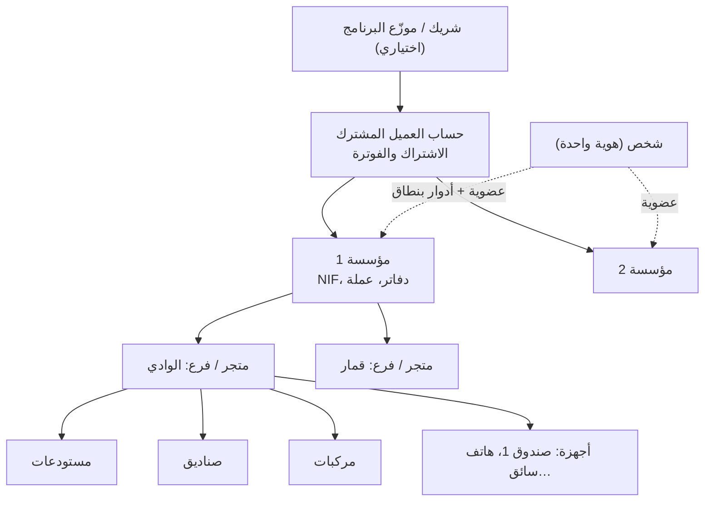
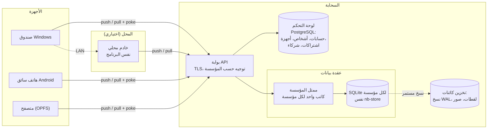
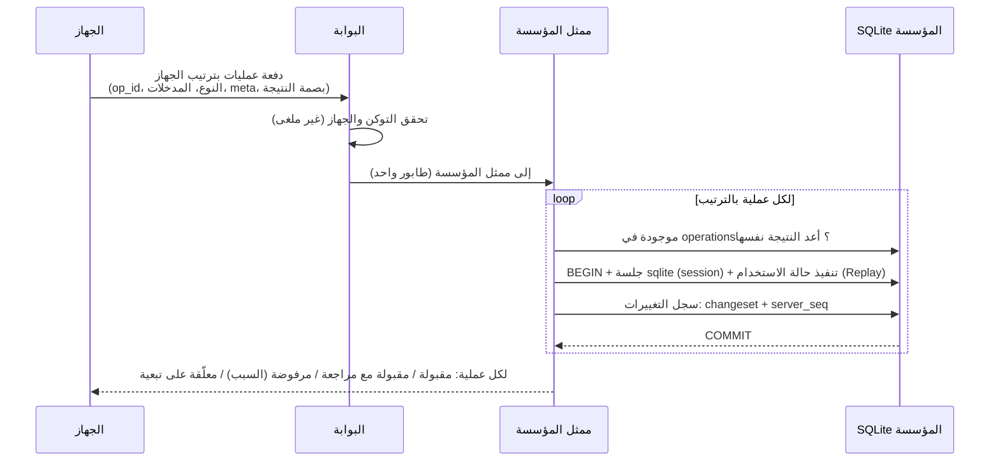
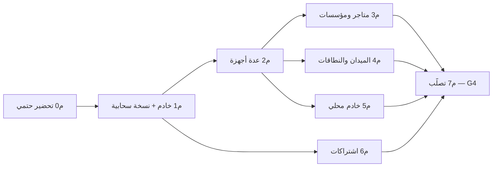

# خطة المزامنة وتعدد المتاجر وتعدد العملاء (M11 المعدّلة)

- **التاريخ:** 2026-11-13 — **الحالة:** مقترحة، تنتظر قرارات المالك في §17 (NEEDS_OWNER O-31).
- **القرار المعماري:** ADR-0006. تحل هذه الخطة محل جدول M11 القديم في `PLAN.md` §13.
- **المراجع:** PRD §8 (Local-First، التعارضات، المخزون دون اتصال)، ADR-0003، ADR-0004، ADR-0005.

---

## 1. الهدف بجملة واحدة
كل جهاز (صندوق، هاتف سائق، حاسوب المكتب، متصفح) يعمل كاملاً دون إنترنت، وعندما يتصل تلتقي كل الأجهزة على **الحالة نفسها بالضبط**: لا فاتورة مكررة، لا دفعة ضائعة، القيود متوازنة، المخزون = مجموع الحركات. وكل هذا لعدد غير محدود من العملاء (المشتركين)، ولكل عميل عدة شركات، ولكل شركة عدة متاجر.

## 2. ما وجدناه عند المنافسين (ولماذا نختلف)

| المنافس | دون اتصال | ما يتعطل | المزامنة |
|---|---|---|---|
| Loyverse | البيع والورديات | **الاسترجاع معطّل**، لا إنشاء/تعديل زبون، لا عرض للمخزون، لا خروج قبل المزامنة | رفع الإيصالات عند العودة |
| Square | الدفع بالبطاقة (حد لكل عملية) | بطاقات يدوية، بطاقات هدايا؛ المدفوعات تنتهي بعد 24–72 ساعة | رفع تلقائي، ما انتهى يضيع |
| Odoo POS | الطلبات تُخزَّن في المتصفح | لا فحص للمخزون، الاسترجاع فقط إن كانت الفاتورة الأصلية مخزّنة، يُنصح بعدم مسح ذاكرة المتصفح؛ **إعادة المزامنة مرتين قد تكرّر الطلبات**، ومنتج أُرشف أثناء الجلسة يُفشل الرفع | رفع الطلبات واحدة واحدة عند العودة |
| Toast / TouchBistro / Aloha | تعمل على **خادم محلي في المحل** | التقارير السحابية والدفع الإلكتروني | الخادم المحلي يرفع للسحابة |
| Symloop / STOCK‑DZpro / Almawarid (الجزائر) | «مزامنة دون اتصال» أو «وضع محلي للانقطاعات» معلَن في خطط معينة | غير موثّق علناً | غير موثّق |

**الدرس:** المنافسون يقبلون «بيع فقط» دون اتصال. ونحن نعد بالعمل الكامل دون اتصال (استرجاع، زبائن، ديون، جولات، جرد…)، لذلك لا يكفي «رفع الإيصالات»: نحتاج إعادة تنفيذ حتمية على الخادم (§5)، ووضع **خادم محلي** في المحل (§11) كما يفعل Toast وAloha، وهو مناسب لانقطاعات الإنترنت في الجزائر.

## 3. الهرم: من العميل إلى الجهاز

| المستوى | ما هو | حدود العزل |
|---|---|---|
| **الشريك** | موزّع يبيع البرنامج ويدعم عملاءه (نموذج البيع الشائع في الجزائر) | يرى اشتراكات عملائه فقط، **لا يرى بياناتهم التجارية** دون إذن صريح |
| **الحساب** | العميل المشترك: يدفع، يملك مؤسسة أو أكثر | الفوترة، المالك، الأشخاص |
| **المؤسسة** | شركة قانونية: دفاتر محاسبية، NIF/RC، عملة | **حد عزل البيانات** (قاعدة مستقلة على الخادم) |
| **الفرع/المتجر** | مكان بيع: رمز الفرع في أرقام المستندات | نطاق صلاحيات وتقارير؛ الكتالوج مشترك داخل المؤسسة |
| **الجهاز** | تثبيت واحد للتطبيق: بادئة فريدة (A، B، …، AA) | مفاتيح الجهاز، الإلغاء عن بعد |
| **الشخص** | هوية واحدة (هاتف/بريد) قد تعمل في عدة مؤسسات (محاسب لعدة عملاء، مالك لشركتين) | عضوية لكل مؤسسة بأدوار بنطاق (المؤسسة/الفرع/المستودع/الصندوق، الموجودة اليوم) |

ما يوجد اليوم: مؤسسة واحدة لكل قاعدة محلية، فروع، مستودعات، صناديق، مستخدمون بأدوار بنطاق، بادئة جهاز في أرقام المستندات. ما ينقص هو: الحساب، الشخص العابر للمؤسسات، الشريك، تبديل المؤسسة على الجهاز (قاعدة محلية لكل مؤسسة)، وتبديل الفرع.

## 4. المعمارية

**القرار الأهم (ADR-0006):** على الخادم، **قاعدة SQLite مستقلة لكل مؤسسة تشغّل شيفرة `nb-store` نفسها** التي تعمل على الأجهزة. أما PostgreSQL فللوحة التحكم فقط (الحسابات، الأجهزة، الاشتراكات).
- **لماذا:**
  1. قاعدة الأعمال مكتوبة مرة واحدة (المال، المخزون، القيود، الصلاحيات)، فلا يختلف الخادم عن الجهاز أبداً.
  2. عزل تام بين العملاء: ملف لكل مؤسسة.
  3. نسخ واسترجاع وتصدير وحذف بيانات عميل واحد عملية بسيطة على ملف واحد.
  4. حجم بيانات عملائنا (متاجر صغيرة ومتوسطة) صغير لكل مؤسسة.
- **الثمن:**
  1. التقارير العابرة للمؤسسات تُبنى بمهام تلخيص.
  2. كاتب واحد لكل مؤسسة: آلاف العمليات في الثانية، وهذا يفوق الحاجة بكثير.
  3. توجيه المؤسسة إلى عقدتها.
- **البديل المرفوض:** PostgreSQL مشتركة مع RLS (الخطة القديمة M11.2)، لأنها تعني إعادة كتابة كل حالات الاستخدام، وخطرها انحراف القواعد بين الخادم والجهاز.
- **المرفوض أيضاً:** CRDT وcr‑sqlite وElectricSQL/PowerSync، لأنها تقوم على «آخر كتابة تفوز» على مستوى الصف، وهذا ممنوع للمال والمخزون (PRD §8.7).

## 5. بروتوكول المزامنة: عمليات تُعاد حتمياً + سجل تغييرات

نستلهم نموذج Replicache (رفع العمليات بالاسم والمدخلات، والخادم يعيد تنفيذها وهو المرجع، والجهاز يسحب الفروق ويعيد تطبيق ما لم يُؤكَّد بعد)، ونكيّفه للمال.

### 5.1 نوعان من العمليات

| النوع | أمثلة | على الخادم |
|---|---|---|
| **وقائع** (حدثت فعلاً، طُبع إيصالها) | بيع، استرجاع، تحصيل دين، حركة مخزون، تحويل، فتح/إغلاق وردية، قيد يدوي مرحّل، محطة جولة منجزة، موقع مركبة | **لا تُرفض لسبب تجاري أبداً.** يُتحقق من سلامتها (الجهاز مسجّل، المنفّذ له الصلاحية وقت العملية). ما يخالف القواعد (عجز مخزون، تجاوز سقف دين، سعر تحت الأدنى) **يُقبل ويُفتح له «بند مراجعة»** مع تنبيه، ولا يُحذف شيء بصمت. |
| **أوامر** (على بيانات مشتركة) | تعديل منتج/سعر، زبون، إعدادات، أدوار، تخطيط جولة، اعتماد طلبية، أرقام وحدات | **تُعاد بالقواعد الكاملة**، وقد تُرفض (تعارض نسخة، صلاحية سُحبت). المرفوض يُلغى أثره المحلي ويُعرض سببه لمن يملك الصلاحية. |

تحمل كل عملية في `OpMeta` حقلاً جديداً `origin`: إما `Local` أو `Replay { at, device, policy }`، والسياسة `AcceptFacts` أو `Strict`. حالات الاستخدام نفسها تقرأ هذه السياسة: مثلاً «المخزون السالب» عند `AcceptFacts` يُقبل ويُسجَّل عجزاً.

### 5.2 التنفيذ الحتمي (أهم شرط)
لكي يعطي تنفيذ العملية على الخادم **النتيجة نفسها حرفياً** التي أعطاها على الجهاز:
1. **المعرّفات:** يأخذ `Writer` مولّد معرّفات مشتقاً من `operation_id` وعدّاد (UUIDv7 بطابع زمني هو وقت العملية + بِتات مشتقة)، بدل `Uuid::now_v7()` المتناثرة اليوم في حالات الاستخدام.
2. **الوقت:** `now` و`hlc` من بيانات العملية المسجلة، لا من ساعة الخادم.
3. **الترقيم:** العدادات بمفتاح يشمل **بادئة الجهاز**. اليوم `doc_counters (kind, branch_id, year)` و`customer_counters` و`supplier_counters` و`plan_counters` على مستوى المؤسسة، وهذا يتصادم بين جهازين. يُضاف ترحيل يجعل المفتاح يشمل البادئة، ورموز الزبائن والموردين تصبح `C-A0001` (أو يبقى الشكل القديم للأجهزة الموجودة، §13).
4. **بصمة النتيجة:** يرسل الجهاز مع العملية بصمة نتيجتها (تجزئة الصفوف التي كتبتها). إن اختلفت على الخادم فهذا «انحراف»: يُسجَّل تنبيه هندسي، ونسخة الخادم هي المرجع، ويصلح السحب الجهاز.

**اختبار القبول الأول (قبل كتابة أي خادم):** خذ قاعدة جهاز حقيقية بعد آلاف العمليات المتنوعة، وأعد تنفيذ سجل عملياتها على قاعدة فارغة؛ يجب أن تتساوى بصمتا الحالتين بايت ببايت.

### 5.3 الرفع (push)

- **ترتيب سببي:** عمليات الجهاز الواحد تُطبَّق بترتيبها. والعملية التي تشير إلى كيان أنشأه جهاز آخر ولم يصل بعد (تحويل يُستلم قبل وصول الإرسال مثلاً) تُعلَّق **ولا تُرفض**، ثم يعاد تقييمها عند وصول تبعيتها.
- **عدم التكرار:** جدول `operations` الموجود هو الـ Inbox: العملية المكررة تعيد النتيجة المخزنة.
- **دفعات وإعادة محاولة:** إعادة المحاولة بتأخير تصاعدي مع عشوائية، ولا يُحذف حدث محلي قبل إقرار الخادم.

### 5.4 السحب (pull)
- كل التزام على الخادم يحفظ **changeset** (امتداد session في SQLite، يدعمه rusqlite) مع رقم تسلسلي `server_seq`.
- الجهاز يطلب `pull?after=<seq>&scope=<نطاقه>` فيحصل على الفروق بالترتيب، ويطبّقها في معاملة واحدة مع حفظ المؤشر.
- **إعادة التأسيس (rebase):** الصف الذي تلمسه عملية محلية لم تُؤكَّد بعد يبقى بقيمته المحلية حتى يأتي إقرارها. بعدها يفوز صف الخادم، وإن رُفضت العملية تُستعاد قيمة الخادم ويُعرض السبب.
- **الإسقاطات تُعاد بناؤها:** أرصدة المخزون وأرصدة الزبائن مشتقة من الحركات وسطور القيود (المبدأ الموجود). بعد كل سحب تُعاد بناء الأرصدة المتأثرة فقط، وفحوص `rebuild_balances` و`customer_drift` الموجودة تصبح جزءاً من المزامنة.
- **التنبيه الفوري (poke):** قناة WebSocket أو SSE بلا محتوى تقول «يوجد جديد، اسحب». والسحب الدوري احتياط فقط.

### 5.5 التهيئة لجهاز جديد (bootstrap)
يولّد الخادم **لقطة SQLite** للمؤسسة ضمن نطاق الجهاز (§7) مع `server_seq`، فيُنزّلها الجهاز بتحميل قابل للاستئناف ثم يكمل بالسحب العادي. بهذا لا يحتاج هاتف جديد إلى مليون عملية.

## 6. سياسات التعارض لكل نوع (توسيع PRD §8.7)

| البيانات | السياسة |
|---|---|
| المبيعات، الاسترجاع، التحصيل، الإيصالات، القيود | وقائع بمعرّفات وأرقام فريدة: اتحاد، بلا دمج ولا إسقاط |
| حركات المخزون والتحويلات | وقائع؛ الرصيد إسقاط. العجز ← **بند مراجعة** + تنبيه حسب سياسة المؤسسة (قبول/تعليق/منع البيع دون اتصال لمنتجات محددة) |
| المنتج، الزبون، المورد (حقول وصفية) | دمج على مستوى الحقل؛ نفس الحقل من جهازين ← الأحدث حسب HLC مع إبقاء القديم في السجل |
| الأسعار، سقف الدين، الإعدادات، الأدوار | أمر بإصدار صريح: تعارض النسخة ← رفض الثاني وعرضه للمراجعة. والخادم هو المرجع في الصلاحيات |
| حالة المستند (اعتماد، إلغاء، تحويل) | آلة حالات: الانتقال غير الصالح ← رفض. مثال: إلغاء طلبية سُلّمت في الميدان يعطي «سُلّمت» + بند مراجعة للإلغاء |
| مفاتيح فريدة (SKU، باركود، اسم منطقة) | الإنشاء **لا يُرفض** إن كانت عليه وقائع تعتمده؛ يُقبل باسم معدّل (`-B`) + بند مراجعة لدمج المكررين |
| الجولات | التخطيط أمر (المخطِّط)، والمحطات وقائع (السائق). محطة أُنجزت بعد أن حذفها المخطط ← تُستعاد + بند مراجعة |
| المواقع | إضافة فقط |
| سجل التدقيق | **سلسلة لكل جهاز** (اليوم سلسلة واحدة للقاعدة)؛ والخادم يتحقق من كل سلسلة |

**شاشة «المراجعات والتعارضات»** لمن يملك الصلاحية: القيمة من كل جهاز، الوقت، المنفّذ، والحل المقترح (قيد تسوية عجز، دمج منتجين، إعادة اعتماد…). والحل نفسه عملية عادية تُزامن.

## 7. ماذا يحمل كل جهاز (النطاقات)

| الجهاز | يحمل |
|---|---|
| صندوق متجر | كل الكتالوج والأسعار، زبائن المؤسسة، مخزون مستودعات فرعه، ورديات صناديقه، سجل 13 شهراً (والأقدم على الخادم يُطلب عند الحاجة) |
| هاتف سائق | الكتالوج، زبائن جولاته ومناطقه، جولاته، **مستودع مركبته**، سجل 3 أشهر |
| حاسوب المالك/المحاسب | المؤسسة كاملة |
| المتصفح | كالحاسوب، مع حد للحجم وتحذير |

- **المرحلة الأولى: نسخة كاملة على كل جهاز.** بيانات عملائنا صغيرة (100 ألف منتج = عشرات الميغابايت)، وهذا يبسّط المفاتيح الأجنبية.
- **النطاقات الجزئية تأتي في مرحلة لاحقة** (§15، م4)، مع قاعدة «إغلاق النطاق»: كل صف تشير إليه بيانات الجهاز يُرسل معه.
- **مخزون المركبة لا يتعارض بالتصميم:** مستودع المركبة «يملكه» جهاز السائق وحده للبيع، فلا يبيع منه جهازان معاً. وهذا أهم ضمان للتوزيع.

## 8. الهوية والأجهزة والأمن

- **الدخول:** الشخص يدخل برقم الهاتف وكلمة مرور (ADR-0007)، ورموز استرجاع بدل SMS في البداية. رمز PIN المحلي الحالي يبقى للتبديل السريع بين الكاشيرات على الجهاز.
- **تسجيل الجهاز:**
  1. المالك يعرض رمز QR أو رمزاً من 8 خانات من «الأجهزة» في الإعدادات.
  2. الجهاز الجديد يمسحه أو يكتبه.
  3. يحصل على `device_id` وبادئة يخصصها الخادم (فريدة في المؤسسة) وزوج مفاتيح.
- **التوكنات:** توكن وصول 15 دقيقة، وتوكن تجديد 30 يوماً مقيّد بالجهاز ويتجدد مع كل استعمال.
- **دون اتصال:** الجهاز يعمل دون حد زمني للبيع. لكن بعد **N يوماً** دون اتصال (تحدده المؤسسة، افتراضياً 14) يظهر تحذير دائم، وتُقفل العمليات الحساسة (تعديل الصلاحيات، الإعدادات) حتى الاتصال.
- **الإلغاء عن بعد:** يسري عند أول اتصال: يُرفع ما تبقى ثم تُقفل القاعدة المحلية، مع خيار المسح.
- **الصلاحيات على الخادم:** الخادم يحفظ **تاريخ المنح والسحب**، ويتحقق من صلاحية المنفّذ وقت العملية (§5.1).
- **التشفير:** TLS 1.3 للنقل. على الخادم تشفير القرص ومفتاح لكل مؤسسة للنسخ. على الجهاز ADR-0004.
- **سجلات الوصول:** وصول فريق الدعم أو الشريك لبيانات عميل لا يتم إلا بإذن من المالك، ويُسجَّل (قانون 25-11 يطلب سجل تشغيل آلي).
- **قانون 18-07:** نقل البيانات الشخصية خارج الجزائر يحتاج **ترخيصاً مسبقاً من ANPDP** (مع استثناءات)، ويلزم تصريح بالمعالجة وتعيين مسؤول حماية بيانات. لذا **أوصي باستضافة داخل الجزائر** أو بالخادم المحلي. القرار للمالك (§17)، ويُراجع مع محامٍ.

## 9. النسخ الاحتياطي والاسترجاع (على الخادم)
- **نسخ مستمر** لملف كل مؤسسة إلى تخزين كائنات (شحن WAL على طريقة Litestream)، مع **استرجاع لأي لحظة** خلال 30 يوماً.
- **لقطة يومية مختومة** (صيغة النسخ المختومة الحالية M14.1) يستطيع المالك تنزيلها في أي وقت، **حتى لو انتهى اشتراكه**: البيانات ملكه.
- **تمرين استرجاع شهري آلي:** يستعيد نسخة ويتحقق منها (توازن القيود، المخزون = الحركات، سلاسل التدقيق).

## 10. تجربة المستخدم للمزامنة
1. **مؤشر الحالة** (PRD §8.5) بأيقونة ونص، مربوط بالمحرك: «متزامن»، «يرفع 12 عملية»، «دون اتصال منذ 3 ساعات — كل شيء محفوظ على الجهاز»، «يوجد تعارض».
2. «زامن الآن»، ونافذة تفاصيل: آخر مزامنة ناجحة، ما ينتظر الرفع، الأخطاء.
3. **صفحة الأجهزة:** الاسم، البادئة، آخر ظهور، العمليات المعلقة، الإصدار، إلغاء.
4. **صفحة المراجعات والتعارضات** (§6).
5. **تحذير قبل الخروج أو إعادة التعيين** إن بقيت عمليات لم تُرفع (Loyverse يمنع ذلك؛ نحن نحذّر ونقدّم نسخة احتياطية).
6. **تبديل المؤسسة** (لمن يعمل في عدة مؤسسات): قاعدة محلية لكل مؤسسة. و**تبديل الفرع** النشط على الجهاز حسب الصلاحيات. مكوّن `store_switcher` في الشريط الجانبي جاهز للربط.
7. **تقارير موحّدة:** للفرع، وللمؤسسة (كل الفروع)، و**للحساب** (كل مؤسسات المالك، من مهام تلخيص على الخادم).

## 11. الخادم المحلي (LAN) والاستضافة الذاتية
- **نفس برنامج الخادم** يعمل على حاسوب في المحل (Windows أو Linux)، فتزامن الأجهزة معه عبر الشبكة المحلية حتى دون إنترنت، وهو يزامن مع السحابة عندما يتوفر الاتصال. البروتوكول نفسه: الخادم المحلي مجرد «جهاز» مميز يحمل المؤسسة كاملة.
- **اكتشاف تلقائي** على الشبكة المحلية (mDNS)، أو عنوان يكتبه المسؤول.
- **وضع «استضافة ذاتية فقط»** لمن يرفض السحابة: خادم في مقره ونسخ إلى قرص خارجي.
- مفيد في الجزائر خاصة (انقطاع الإنترنت، صناديق متعددة في متجر كبير، تحفظ بعض العملاء من السحابة).

## 12. الاشتراك والشركاء (SaaS)
- **الخطط:** حسب عدد المؤسسات والفروع والأجهزة، مع فترة تجربة. الفوترة بالدينار، والدفع بـ CIB/الذهبية عبر بوابة دفع جزائرية، أو تحويل بنكي أو بريدي يؤكده الإداري يدوياً.
- **عدم الدفع لا يوقف البيع:** 30 يوم سماح مع تنبيه، ثم تتوقف المزامنة وتبقى الأجهزة تعمل محلياً، والتصدير والنسخ متاحان دائماً.
- **بوابة الشريك:** عملاؤه، اشتراكاتهم، التجديد، الدعم بإذن.
- **لوحة إدارة المنصة:** المؤسسات، العقد، الحجم، الصحة، نقل مؤسسة بين العقد.

## 13. نقل التثبيتات الحالية دون مشاكل
اليوم كل جهاز أنشأ مؤسسته الخاصة محلياً (معرّفات مختلفة). القاعدة: **مؤسسة سحابية واحدة لكل نشاط، وجهاز «بذرة» واحد.**
1. معالج «ربط بالسحابة» على الجهاز الذي يحمل البيانات الحقيقية:
   - إنشاء الحساب.
   - رفع لقطة القاعدة كاملة، فيتبنّى الخادم المؤسسة **بمعرّفاتها نفسها** وتحتفظ البذرة ببادئتها.
   - ترحيل العدادات إلى المفتاح الجديد دون تغيير الأرقام السابقة.
   - التحقق: بصمة القاعدة على الخادم = بصمة الجهاز.
2. الأجهزة الأخرى تنضم بـ«انضمام إلى مؤسسة موجودة».
   - إن كان على الجهاز بيانات تجريبية فقط تُحذف بعد نسخة احتياطية تلقائية.
   - إن كان عليه **بيع حقيقي** (حالة نادرة) فأداة «استيراد سجل جهاز» تعيد تنفيذ عملياته داخل المؤسسة المستهدفة مع ربط الفروع والمستودعات. هذه أداة مراجَعة يدوياً وليست تلقائية.
3. **لا شيء يضيع:** نسخة مختومة قبل أي خطوة، والعودة ممكنة.

## 14. التوافق بين الإصدارات
- لكل عملية **إصدار مخطط مدخلاتها**. الخادم يرقّي المدخلات القديمة (serde مع قيم افتراضية + محوّلات صريحة)، ويقبل عملاء آخر **إصدارين رئيسيين**.
- العميل الأقدم من ذلك ينتقل إلى «قراءة + بيع محلي فقط» مع رسالة تحديث واضحة، **ولا يرفع** إلى أن يُحدَّث. لا يفقد شيئاً.
- ترحيل القاعدة المحلية تسبقه نسخة تلقائية (موجود).
- الخادم يحدّث ملفات المؤسسات **تدريجياً** عند أول وصول، مع نسخة قبل الترحيل.

## 15. المراحل (مع معايير القبول)

| المرحلة | المحتوى | معيار القبول | جلسات |
|---|---|---|---|
| **م0 — التحضير في العميل** (بلا خادم) ✅ 2026-11-13 (الجوهر؛ `AcceptFacts` والعمليات المبهمة في م2) | سجل العمليات بمدخلاتها (`operations.input`)؛ سجل حالات الاستخدام الكاتبة `ops::apply(kind, input)`؛ مولّد معرّفات ووقت حتمي في `Writer`؛ `OpMeta.origin`؛ عدادات ببادئة الجهاز (ترحيل)؛ سلسلة تدقيق لكل جهاز؛ بصمة الحالة | **إعادة تنفيذ سجل قاعدة حقيقية على قاعدة فارغة = البصمة نفسها**؛ اختبار خاصية على آلاف العمليات العشوائية | 6 |
| **م1 — الخادم ونسخة سحابية لجهاز واحد** 🟡 الجزء الأول 2026-11-13 (الخادم، الربط، الإرسال، التحقق؛ باقٍ: الحسابات والدخول، النسخ المستمر، الاسترجاع للجهاز) | `nb-server` (Axum)، لوحة تحكم PostgreSQL، ممثل المؤسسة + SQLite لكل مؤسسة، push/pull، changesets، لقطة bootstrap، الحساب والدخول وتسجيل الجهاز، النسخ المستمر، معالج «ربط بالسحابة» | جهاز واحد يعمل أسبوعاً مع انقطاعات عشوائية: الخادم = الجهاز؛ استرجاع لأي لحظة ناجح. **قيمة فورية للمالك:** نسخة سحابية وتقارير من الويب | 8 |
| **م2 — عدة أجهزة في فرع واحد** ✅ 2026-11-14 (السحب، الانضمام بالحساب أو بالرمز، الحقب، `AcceptFacts`، المراجعات والعمليات المرفوضة، الأجهزة وإيقافها، صندوق لكل جهاز، إشعار فوري بالانتظار الطويل `/v1/wait` بدل WebSocket (يعمل بـ fetch على كل المنصات)، محاكٍ حتمي: 1000 سيناريو متتالٍ) | السحب مع rebase، إعادة بناء الإسقاطات، `AcceptFacts`، بنود المراجعة، شاشة التعارضات، مؤشر الحالة، صفحة الأجهزة، poke عبر WebSocket | **محاكي حتمي** (`tests/sync-sim`): 5 أجهزة، تقطّع، تكرار، انحراف ساعات، إعادة تشغيل في منتصف المزامنة، 10 آلاف سيناريو: لا تكرار، لا فقد، القيود متوازنة، المخزون = الحركات، تقارب كامل | 8 |
| **م3 — تعدد المتاجر والمؤسسات** 🔶 2026-11-14 (الحسابات والعضويات، حساب بعدة متاجر واختبار العزل، تحويل بين فرعين على جهازين؛ المتبقي: التبديل بين المتاجر على جهاز واحد، تقارير موحّدة) | الشخص العابر للمؤسسات والعضويات والدعوات، تبديل المؤسسة والفرع، تحويلات بين فروع على أجهزة مختلفة، تقارير موحّدة للمؤسسة والحساب، أسعار وتوفر لكل فرع | تحويل يُرسل من صندوق فرع ويُستلم في فرع آخر دون اتصال متزامن؛ مالك بمؤسستين يرى كلتيهما ولا يتسرب شيء بينهما (اختبار عزل) | 6 |
| **م4 — الميدان والنطاقات** | نطاقات جزئية وسجل بنافذة زمنية على الهواتف، ملكية مستودع المركبة لجهاز، **تتبع حي** (المكتب يرى إنجاز المحطات والتحصيل لحظياً)، المواقع من التطبيق المفتوح | سائق دون إنترنت يوماً كاملاً ثم يتصل: كل شيء يصل مرة واحدة؛ هاتف بنطاقه ≤ 20% من حجم المؤسسة | 5 |
| **م5 — الخادم المحلي والاستضافة الذاتية** | نفس الخادم على حاسوب المحل، اكتشاف LAN، سلسلة جهاز ← محلي ← سحابة، حزمة تثبيت Windows | 3 صناديق على LAN دون إنترنت يومين ثم يعود الاتصال: تقارب كامل | 4 |
| **م6 — الاشتراكات والشركاء** | الخطط، الفوترة بالدينار، بوابة دفع، السماح، بوابة الشريك، لوحة المنصة | دورة اشتراك كاملة في بيئة الاختبار | 5 |
| **م7 — التصلّب والإطلاق (بوابة G4)** | اختبار حمل (1000 مؤسسة × 10 أجهزة)، فوضى (قتل العقد، فساد شبكة)، مراجعة أمنية واختبار اختراق، تمرين كوارث، توثيق التشغيل، Docker Compose | أهداف الأداء في §16، ولا عيب حرج مفتوح | 6 |

**المجموع: حوالي 48 جلسة.** وكل مرحلة تُدفع للمالك قابلة للاستعمال. الترتيب م0 ← م1 ← م2 إلزامي. م3 وم4 ممكن بالتوازي، وم5 وم6 حسب أولوية المالك.

## 16. أهداف قابلة للقياس
- رفع عملية بيع حتى إقرار الخادم: أقل من ثانية واحدة (p95) مع اتصال 4G.
- وصول تغيير إلى جهاز آخر متصل: أقل من 3 ثوانٍ (p95) عبر poke.
- تهيئة هاتف جديد بمؤسسة فيها 100 ألف منتج: أقل من دقيقتين على 4G.
- صفر عمليات مالية مكررة أو مفقودة في المحاكي (مليون عملية).
- استرجاع مؤسسة من النسخ المستمر: أقل من 15 دقيقة.
- عقدة خادم واحدة (8 أنوية) تخدم 2000 مؤسسة نشطة.

## 17. قرارات للمالك (O-31)
> **قُرّرت في 2026-11-14 — انظر ADR-0007.** (داخل الجزائر؛ الهاتف + كلمة مرور ورموز استرجاع؛ زبائن مشتركون؛ مباشر وشركاء؛ خطط لكل مؤسسة؛ تحذير 7 أيام وقفل الإعدادات بعد 14.)

1. **الاستضافة:** داخل الجزائر (أبطأ في الإعداد وأسلم قانونياً) أم خارجها مع ترخيص ANPDP؟ أم خادم محلي فقط في البداية؟
2. **الدخول:** رقم الهاتف + SMS (يحتاج مزوّد SMS) أم البريد الإلكتروني؟
3. **نموذج البيع:** مباشر أم عبر شركاء/موزّعين أم الاثنان؟
4. **التسعير:** لكل مؤسسة أم فرع أم جهاز؟
5. **الزبائن بين الفروع:** مشتركون (دين واحد للزبون في كل الفروع) أم لكل فرع زبائنه؟
6. **أقصى أيام دون اتصال** قبل قفل العمليات الحساسة (اقتراحي 14).
7. **البدء:** هل نبدأ بـ م0 فوراً؟ لا يحتاج أي قرار مما سبق.

## 18. المخاطر وعلاجها

| الخطر | العلاج |
|---|---|
| حالة استخدام غير حتمية تُكتشف متأخراً | م0 قبل الخادم + اختبار خاصية + فحص بصمة النتيجة في الإنتاج |
| تعقيد rebase على SQLite | الإسقاطات قابلة لإعادة البناء أصلاً؛ الصفوف المعلقة «مظللة» فقط؛ المحاكي يغطي الحالات |
| بطء ممثل المؤسسة في متجر كبير | كاتب واحد بآلاف العمليات/ث، ودفعات، ونقل المؤسسة لعقدة أقوى |
| ضياع بيانات على الخادم | نسخ مستمر + لقطات + تمرين استرجاع آلي + بصمات |
| تسرب بين عملاء | ملف لكل مؤسسة + توجيه موقّع + اختبار عزل في CI |
| NSH: لا مزامنة في الخلفية على الهاتف | مزامنة عند الفتح والعودة وكل 30 ثانية أثناء الاستعمال؛ الحاجة ضعيفة لأن السائق يستعمل التطبيق أصلاً |
| إصدارات قديمة في الميدان | محوّلات مدخلات + نافذة إصدارين + قراءة فقط دون فقد |
| انقطاع الإنترنت الطويل في الجزائر | العمل الكامل دون اتصال + الخادم المحلي |

## 19. المصادر
- [Loyverse — العمل دون اتصال](https://help.loyverse.com/help/offline-work-of-pos)
- [مقارنة الأنظمة عند انقطاع الإنترنت (Toast، Square، Clover، Lightspeed، TouchBistro…)](https://www.katalystos.com/blog/what-happens-to-your-pos-when-the-internet-goes-down)
- [Odoo POS — وضع عدم الاتصال](https://deploymonkey.com/blog/odoo-pos-offline-mode-guide)
- [Replicache — آلية العمل](https://doc.replicache.dev/concepts/how-it-works)
- [ZoomAlgérie — برامج الصندوق في الجزائر](https://zoomalgerie.com/logiciel-caisse-pos-algerie/)
- [ZoomAlgérie — برامج المخزون في الجزائر](https://zoomalgerie.com/?p=17160)
- [Gide — حماية المعطيات الشخصية في الجزائر](https://www.gide.com/en/news-insights/protection-of-personal-data-focus-on-algerian-regulations/)
- [UpGrowth — قانون المالية 2026](https://www.upgrowth.dz/loi-de-finances-2026-articles-cles-algerie)
